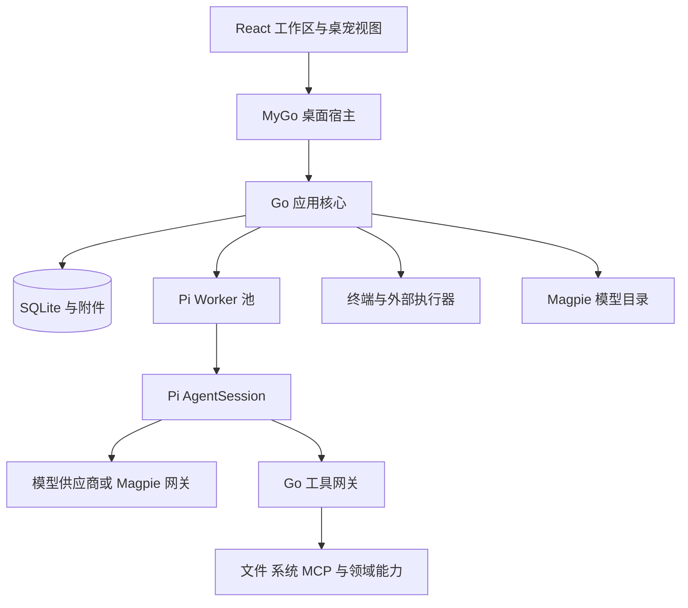

# 01 · 整体系统、进程与模块

## 1. 部署拓扑



图中的 Go 应用核心、工具网关、调度器和各领域服务是同一进程内的模块。SQLite 属于同一个用户配置目录。Pi worker 是宿主管理的私有子进程；外部 CLI 是另一类受管理或被附着的进程。所有箭头都应落实到契约，不允许跨层直接访问他方内部对象。图中工具路径是 managed 能力的唯一执行入口；trusted-native 扩展可能直接访问本机或外部服务，必须单独声明其边界。

Go 可执行程序同时拥有 MyGo 主线程和应用 supervisor，首版不另建常驻系统 daemon。退出主窗口默认隐藏到托盘；显式退出执行有界收尾并退出应用。未来若需要用户退出 UI 后仍有独立系统服务，可替换 `HostTransport`，领域接口无需变更，但这不属于首版默许行为。

## 2. 三条互相配合的链

**交互链**：UI 发命令 → Go 校验并提交 → 立即返回对象 ID → UI 订阅快照与事件。它负责“用户做了什么”和界面可恢复状态。

**执行链**：Scheduler 获得分支和资源额度 → PiBridge 装配上下文 → AgentSession 推理与工具循环 → ToolGateway 执行 → Go 持久化结果。它负责“系统实际做到了哪一步”。

**连续性链**：事件进入记忆候选、关注事项和情绪 reducer → 后台整理或确定性更新 → 合适时机投递。它负责“经历如何留下来、以后何时重新出现”。不能把这条链简单放在 React 的 `useEffect` 中。

## 3. Go 领域模块

| 模块 | 拥有的事实 | 对外主要能力 | 明确不承担 |
|---|---|---|---|
| `identity` | assistant、persona 版本、明确用户偏好设置 | `GetIdentitySnapshot`、`UpdatePersona` | 不保管所有对话正文 |
| `sessions` | 会话、分支、消息、Pi entries、分支写入租约 | `SubmitInput`、`ForkBranch`、`GetTimeline` | 不生成长期事实 |
| `runs` | Run/attempt、状态、输入快照、恢复关系 | `SubmitRun`、`CancelRun`、`RecoverRun` | 不复制 Pi 推理循环 |
| `scheduler` | 队列、lane、公平性、租约、任务预算 | `AcquireCapacity`、`WakeDueJobs` | 不用模型决定所有排队规则 |
| `pi` | worker 生命周期和 adapter 版本 | `StartAttempt`、`Checkpoint`、`Abort` | 不直接持久化业务表 |
| `tools` | 工具注册、执行记录、权限、审批、资源锁 | `PrepareTool`、`ExecuteTool`、`Reconcile` | 不信任模型自称已获授权 |
| `context` | 可用预算、覆盖区间、压缩视图和审计 | `Assemble`、`RequestCompaction` | 不删除原始历史以缩短 prompt |
| `memory` | 有来源的长期记忆、版本、关系、冲突 | `Retrieve`、`Propose`、`Commit`、`Forget` | 不将情绪当检索相关性 |
| `consolidation` | 整理游标、批次、租约、提议 | `RunBatch`、`RetryBatch` | 不随意重写人格 |
| `planner` | 任务、事件、提醒规则、执行关联 | `UpsertItem`、`MarkDone`、`BuildWeekDraft` | 不把通知已读当完成 |
| `executors` | 终端、外部 session、执行能力与结果证据 | `Launch`、`Attach`、`Resume`、`Stop` | 不冒充 Codex/OpenCode 内部大脑 |
| `attention` | 目标关注与条件、事实指纹 | `Observe`、`EvaluateDue`、`Resolve` | 不扩大数据访问范围 |
| `initiative` | 行动意图、排序与预算消耗 | `ProposeIntention`、`EvaluateEligibility` | 不直接弹 UI 或外发消息 |
| `affect` | 全局心情与原因事件 | `ApplyAppraisal`、`ReadDecayedState` | 不决定权限和事实 |
| `delivery` | 投递、去重、时机和已读 | `Enqueue`、`Present`、`Acknowledge` | 不修改任务业务状态 |
| `presentation` | 当前展示仲裁、表情计划 | `ResolveExpression`、`ClaimSurface` | 不驱动高频模型推理 |
| `models` | Magpie 快照、role binding、能力覆盖 | `ResolveModel`、`RefreshCatalog` | 不维护另一份手工全球目录 |
| `capabilities` | 内建模块、Pi extension、MCP、skill 元数据 | `Discover`、`Enable`、`ReloadWhenIdle` | 不把所有插件视作同等隔离 |
| `platform` | 窗口、托盘、快捷键、通知、设备状态 | 跨平台接口及各 OS 实现 | 不拥有 Run 或记忆 |
| `observability` | 脱敏 trace、健康状态、用量聚合 | `Record`、`ExportDiagnostics` | 不成为必须成功的业务事务依赖 |

已进入正式设置的偏好键只有一个当前值；用户在自然语言中明确修改时，转成所属领域设置命令，Memory 只记录来源和设置版本引用。其他长期相处偏好归 Memory，不在两处各存一份当前值。

所有模块通过构造函数注入接口。事件订阅用于后续反应；必须立即确定成功与否的写操作使用显式命令和事务，不能靠异步监听器偷偷完成核心数据写入。

## 4. 目录建议

```text
cmd/chela/                         桌面入口与启动装配
internal/app/                      supervisor、服务图、退出顺序
internal/domain/<module>/          领域模型、命令、策略、port
internal/adapters/sqlite/          各模块 repository 与事务单元
internal/adapters/pi/              IPC、worker池、版本适配器
internal/adapters/magpie/          目录和模型路由
internal/adapters/executors/       Codex、OpenCode、PTY
internal/adapters/mcp/             MCP连接与工具映射
internal/platform/{windows,darwin,linux}/
internal/transport/mygo/           typed bridge与事件订阅
worker/src/bridge/                 PiBridge、checkpoint、错误转换
worker/src/extensions/             Chela官方Pi扩展
web/src/{features,components,bridge,stores}/
contracts/                        唯一跨语言协议定义
migrations/                       有序数据库迁移
tests/{contract,integration,fixtures}/
docs/{architecture,migration}/
history/                          已归档旧实现（按现有仓库决定）
```

这是职责建议，不要求把现有相同职责的目录全部改名。开工先绘制实际目录到上述职责的映射；能复用就复用，避免为目录整齐而大规模搬迁。

## 5. 生命周期与服务依赖

启动顺序：配置与单实例锁 → 日志与本地密钥入口 → SQLite/迁移/恢复扫描 → repository 与事件/outbox → 工具权限与模型目录缓存 → sessions/runs/scheduler → Pi worker 版本握手 → attention/memory/affect/delivery → MyGo 窗口和托盘。UI 可以先展示启动状态，但迁移未完成时不接受业务写入。MyGo bindings 生成路径可能执行入口；有副作用初始化只放实际运行 ready 路径，生成类型不得启动后台服务或迁移用户数据。

`Service` 最低接口为 `Name, Dependencies, Start(ctx), Stop(ctx), Health()`。Start 必须幂等，失败不能留下重复计时器或订阅；只有全部初始化成功才标为 ready。关键服务失败会阻止可写运行；可选服务失败进入 degraded，并具体说明哪个能力不可用。停止按依赖反序，先拒绝新任务，再取消/收尾执行，最后 flush outbox 和关闭 DB。

重启恢复扫描只读取事实并分类：未开始的 Run 回队列；执行中 attempt 标 `interrupted`；副作用状态未知的工具进入 reconciliation；未到期关注、待投递通知恢复；已过期提醒按各自 catch-up 规则处理。不得在启动瞬间自动重复所有上次“尚未成功”的命令。

## 6. 身份、会话、分支、Run、attempt、worker

| 对象 | 生命周期 | 关系 |
|---|---|---|
| assistant | 用户空间长期存在 | persona、全局情绪、允许共享的长期记忆归属于它 |
| session | 一段话题或工作现场 | 属于 assistant，可关联 project |
| branch | 会话中的一条历史路径 | 保存 parent、leaf、generation；编辑旧消息可产生新分支 |
| Run | 一次逻辑委托 | 来源为用户/后台/恢复，引用输入、scope、预算和目标分支 |
| attempt | 一次具体执行尝试 | 绑定 Run、worker_id、worker_epoch、Pi entry 起点 |
| worker | 私有 Node 子进程 | 可顺序承载多个 attempt；不拥有身份，不作为恢复真相 |
| terminal session | 外部交互现场 | 独立 PTY/CLI，关联任务和外部 provider session ID |

没有原始聊天的主动/整理/子任务 Run 使用隐藏 internal session 与独立 branch；origin_session_id 可空，执行 branch 必有。它们不自动出现在普通聊天列表，也不借用用户正在看的会话。

worker 复用键至少包含 workspace、扩展集合及版本、信任类别。managed 扩展的会话状态限定在实例和持久 entries 中；可能保留全局变量、计时器和原生句柄的 trusted-native 扩展默认绑定会话或在切换前重启进程，dispose 不等于清除了任意第三方模块状态。

UI 选中的会话只是视图选择。任何命令、回调、模型流都必须显式携带所属对象 ID，不能读取可变的全局 `activeSession` 来决定写到哪里。

## 7. 调度与资源

初始额度：前台内部 Run 同时 2 个、后台内部 Run 同时 1 个，总 Pi worker 上限 3；外部 PTY 默认最多 4 个活动进程，用户可调整。前台 Run 按用户提交时间排队，同用户空间 round-robin 兼顾不同会话；后台采用优先级与 aging，避免空闲整理永远饿死。

worker slot、模型并发额度、项目写锁和工具并发额度分别管理。等待审批不占模型请求额度；为了保留扩展内存，warm worker 可短暂保留，达到闲置期限再 checkpoint/dispose。重新恢复走 adapter 能力检查，不能把 wait Promise 序列化。

后台只在可安全 checkpoint 的边界让出 worker；正在执行的外部写操作不被粗暴暂停。用户任务获得优先额度，后台整理延期；不可通过无限创建新 worker 绕过队列。超额时 UI 显示队列位置和可取消状态，不显示永远转圈的“思考中”。

资源锁按稳定键定义，例如 `workspace:<canonical-root>` 的写锁、`file:<canonical-path>` 的操作锁。同项目两个 Codex 可以读；同时修改同工作树应排队、用户明确接受冲突，或由执行器创建独立 worktree。默认不把不同会话误当成不同文件系统。

## 8. 预算与隐私边界

每个 Run 固定 `RunScope`：可见 project/session、允许资料源、工具授权、输出目标和预算。Memory 和 Context 接收 scope 后先过滤，再检索和压缩。persona 与情绪原因只传最小解释标签，不能借“全局状态”夹带另一个项目的秘密文本。

模型调用对外传输的内容由模型配置和 RunScope 决定。引用大文件使用本地 blob 引用，在真正发送模型前按需求读取、截断和计量；本地路径、密钥和隐藏配置不因 worker 自己扫描 `$HOME` 而自动进入上下文。凭据放系统密钥存储；worker 获得当前调用所需的短作用域访问，不把所有凭据塞进启动环境。

## 9. 主要成本来自哪里

延迟应分解为队列、上下文装配、检索、模型首 token、工具与持久化；内存应按宿主、每个 worker、WebView、模型/嵌入分别记录。语言替换本身不保证模型回复更快。Go 的价值是系统边界与并发编排明确；worker 复用的价值是减少反复加载 SDK 和扩展；不能用复用牺牲会话隔离或崩溃恢复。

首轮性能门禁使用同一机器和相同模型配置对比旧版；记录空闲内存、双会话响应、1000 条消息滚动、重连、退出和重启。预算阈值由测量后写入发布配置，本设计不编造已经达到的毫秒或内存承诺。
