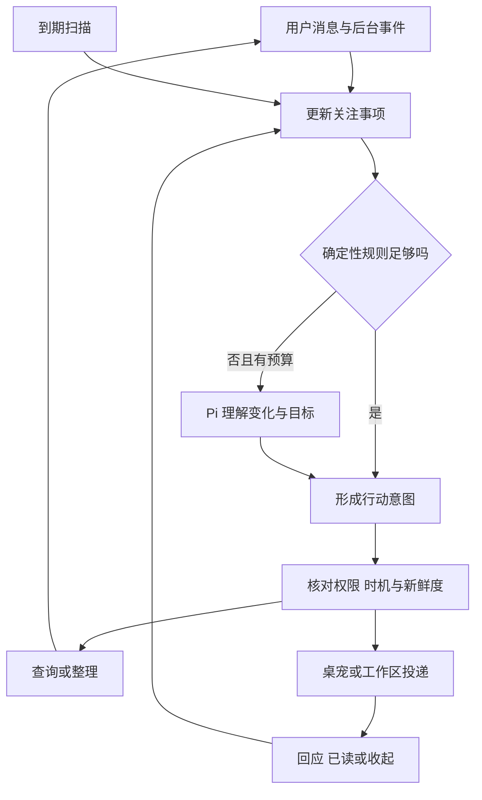

# 04 · 主动性、角色连续性与情绪系统

本章定义 Chela 在没有当前用户消息时如何继续关注事情，以及同一个角色如何跨会话保持心情和表现的连续性。所有分数、半衰期和预算均为首版可调默认值，不是心理学定律，也不是已经测得的最佳参数。它们属于可解释的产品行为规则。生成式智能体研究中的观察、记忆、反思、规划可提供设计参考；本方案没有直接复制其模拟环境或行为质量结论。[P1]

## 1 产品不变量

1. 一个用户配置下只有一个稳定的 `assistant_id`。聊天窗口、项目、Run、Pi worker 都不是新的角色实例。
2. 人格长期稳定；心情有来源、可混合、会衰减；表达随会话语境变化。A 会话里的肯定可以影响 B 会话开始时的神态，但 A 的源码、工具输出、审批不会因此进入 B。
3. 用户没发消息、没设提醒时，Chela 可以审视尚未解决的关注事项，形成查询、建议或汇报意图。
4. 后台运行不意味着持续调用模型。事件记录、到期扫描、状态衰减、表情动画都可在本地完成。
5. 情绪只调节措辞、动作和有限的交流主动性。它不能改变事实、权限、任务优先级的硬约束、结果归属或任务完成标准；不能通过拒绝办事、隐瞒进度、要求安抚来惩罚用户。

## 2 五类状态及所有权

| 实体 | 要保存的内容 | 唯一修改方 |
|---|---|---|
| `AttentionItem` 关注事项 | 惦记的目标、为何关注、来源、条件、适用范围、下次审视、结束条件 | Attention Service |
| `Intention` 行动意图 | 准备做什么、为什么现在做、依据、代价、目标对象、失效条件 | Initiative Service |
| `Delivery` 投递 | 哪句话、展示到哪里、动作入口、时机、已读和撤销状态 | Delivery Service |
| `AffectState` 全局心情 | 六维分数、基线、最后演算时间、原因事件、版本 | Affect Reducer |
| `ExpressionContext` 本次表达 | 当前话题、任务阶段、严肃程度、用户明确语气要求、显示场所 | 表达装配器按次生成 |

这些实体共用事件信封、稳定对象引用和事务机制，不能让各插件分别维护同名“全局情绪”或“已经提醒过”。Memory 保存长期相处偏好及值得保留的经历；运行中的关注、投递和心情有自己的结构化记录，不能仅靠向量检索恢复。

## 3 关注事项如何产生和结束

创建来源包括明确安排、当前对话中的未完成目标、工具返回的阻塞、项目数据变化，以及已有关注事项的重新评估。例如“帮助中心这周想收尾，还差三张截图”可形成一个关注事项；原话、消息 ID、项目、时间范围必须随记录保留。

模型抽取结果是提议。Go 检查引用存在、项目可见、结束条件可表示、同一目标是否已存在，然后创建或更新。仅在已接入资料范围内观察的关注项可自动生效；它不授予新增数据源、执行命令或外发消息的权限。没有足够依据时保留 `candidate`，不要编造截止日、对方承诺或用户偏好。

关键字段：`id, assistant_id, scope, project_id?, origin_session_id?, source_refs[], goal, condition, state, priority, revision, next_review_at, expires_at?, last_evaluated_event_seq, last_fact_fingerprint, resolution_reason?`。`condition` 使用版本化类型，如 `all_artifacts_present`、`task_blocker_cleared`、`deadline_approaching`、`semantic_review`；不把模型生成代码当条件执行。

状态为 `candidate → active ↔ waiting → resolved/cancelled/expired`。显式结束、项目归档、目标被新决定替代都触发复核。普通“收起气泡”只改变 Delivery；“这次别提醒”处理本次 Intention；“以后不要提醒这个项目”更新范围明确的设置并取消对应未投递意图。不能把这三种操作合成一个布尔值。

跨会话重复提到同一目标，优先按项目和显式对象 ID 关联；语义相似只生成合并候选。两件标题相似但来源不同的任务不能自动合并。自动建立的关注事项在界面可查看原因和停止关注。

## 4 没有新消息时的主动循环

采用“事件唤醒 + 到期关注扫描”。事件有本地任务变更、可靠 CLI 回执、同步完成、系统启动/解锁、前台忙闲变化、用户回应、关联资料变化。只订阅用户已接入来源；默认不读取全屏文字、键盘输入或其他应用私密内容。订阅采用明确事件白名单；`affect.changed`、动画结束、气泡已展示和模型自己生成的措辞不再次触发情绪评估或新关注，防止系统对自己的表达反复反应。由自动化产生的事件保留 causation 链，在无新事实时不得再次创建同一意图。

Go 以 `next_review_at` 的最小值安排唤醒，15 分钟心跳仅作漏触发兜底。唤醒先用 SQL 找到到期关注项，最多批处理 20 项；无到期项直接结束。已知条件直接计算；需要理解新事实、合并目标或解释优先级时才产生低优先级 Pi Run。新事件和定时复核可用同一个关注 ID 合并，避免重复推理。所有主动 Run 仍通过统一 AgentSession 执行层，不另写第二套 Agent 循环；后台初始并发 1、前台初始并发 2，共用调度与资源预算，均为可调起点。没有原始聊天的关注项使用不显示在聊天列表里的内部 session 和 branch；`origin_session_id` 可以为空，执行分支不能借用当前活动聊天。

首版主动推理默认：每次最多 4,000 输入 token、512 输出 token；同一关注项无实质变化时至少间隔 30 分钟；全局最多每小时 4 次、每日 12 次，可将多个关注项放入一次判断。这个预算只限制自发推理，不占用户正在聊天或明确委托任务的执行配额。显式到点提醒通过确定性规则投递，不因主动推理预算耗尽而漏掉。

模型不可用时仍记录变化、计算明确条件、显示真实状态和预设提醒；需要语义理解的意图延后。重启只补查尚未过期且仍有关联的内容，合并成摘要，不把关机期间每次心跳逐一重放。

## 5 意图决策与打扰控制

Pi 返回结构化 `IntentionProposal`：`attention_id, attention_revision, kind, reason, evidence_refs, expected_benefit, urgency, confidence, expiry, target_ref, proposed_action?`。允许的 kind 为 `silent_update/read_more/suggest/notify/prepare_draft`；实际副作用动作始终进入统一工具和授权流程。模型建议绝不能携带“我已经发出”“我已经完成”等未发生结果。

硬门槛先于排序：对象可见、引用仍有效、源版本未被取代、未处理、未过期、没有更高优先级同类意图。其后用初始评分 `S=0.35×相关性+0.25×时效性+0.20×可行动性+0.20×新颖度−0.30×打扰成本`，所有输入限制为 0～1。分数只是排序工具，不能提高权限或绕过免打扰；低置信语义提议默认留工作区，不直接弹出。

先按用户显式要求和到期事实分优先级，再在同级内比较 S。普通变化的首版候选阈值是 S≥0.45；否则安静更新或并入晨报。将同一项目 60 秒内的低优先级变化合成一条，每个关注事项在相同事实指纹下最多主动提示一次。新截止时间、解除阻塞、新回复版本属于实质变化。

免打扰、用户选择的游戏模式、全屏模式会推迟普通弹出。用户明确授权的例外由配置判断，模型无权自行宣布“紧急”。离线、锁屏、静默时仍保存 Intention，不标记已投递。解除静默时重查真实状态，再在用户回来后的首个合适空隙显示一条合并提示；不连续弹队列。

陪伴性主动聊天采用独立配额：首版默认每日最多 1 次，距上次无请求开口至少 4 小时，只在非专注、非游戏且用户最近有互动时考虑。长期不回应会降低主动频率，绝不生成“你不理我所以我难过”类负担。用户明确关闭时彻底停用该来源，工作提醒仍按各自设置运行。

## 6 投递是一条可恢复的业务记录

`Delivery` 保存 `id, intention_id, source_versions, status, surface, text, actions[], not_before, expires_at, dedupe_key, delivered_at?, seen_at?, dismissed_at?`。状态为 `pending/deferred/presented/seen/dismissed/revoked/expired`。发送前最后一次验证来源版本和目标状态；只有可靠的 `reply_seen(result_ref, version)`、明确处理回执或 `dismiss_same_fact` 能撤下对应“有新回复待查看”的提醒，不重新解释成新意图。终端窗口可见、被聚焦或进程退出，都不足以证明用户看过该回复或已经处理任务。

每个动作是稳定内部路由，例如 `open_terminal(terminal_session_id, task_id, result_event_id)`，不能靠模型生成路径或按钮文字定位。开发任务点击后回到原 Codex/OpenCode 现场；Chela 自己的建议可指向原对话，或创建 `origin=proactive` 的对话并关联来源。当前正在输入的会话草稿不得被通知抢焦点。

同一桌宠窗口由 Presentation Coordinator 串行调度，最多一条主动气泡；同一时刻多个 Run 不可同时改脸或抢说话。优先展示用户直接交互，其次用户要求的提醒，再其次普通主动提示，空闲动作最后。`seen` 只表示查看，不能修改任务完成状态。UI 重连按投递游标恢复未读内容，不重复播放已展示动作。

## 7 人格 心情与表达的三个时间尺度

`PersonaProfile` 保存用户选择的角色说明与版本、称呼、幽默尺度、关怀程度、好胜敏感度、情绪反应幅度、恢复速度、主动程度。它按版本变更，模型不得自行重写。相处偏好进入有来源的 Memory；无需设置会被夸奖“充值”的好感值来决定服务质量。

`AffectState` 保存持续数分钟至数小时的混合情绪。建议首版六维：`joy/pride/playful_irritation/concern/curiosity/disappointment`，各为 0～100。它能表达“开心又有点别扭”。效价和唤醒度只作为这六维的派生显示指标，不另外持有一份会与主状态冲突的分数。Russell 的二维情感表示可用来解释这种投影；这里的六维、基线与公式是 Chela 产品设计。[P2]

`ExpressionContext` 只活在本次回应里，包括会话明确要求、当前正在解释错误还是闲聊、展示位置、最近语境。它只控制心情被表达多少，不偷偷重写全局心情。工作问题默认降低玩笑和戏剧动作，继续保留称呼、语感和很轻的余味；用户选择严肃模式时隐藏玩笑表现但保留可衰减状态。

模型每次读取 `persona_version + affect_snapshot_version + expression_context`，先理解和完成任务，再在这些边界内组织语言。切模型不清空角色；切会话不重置心情；同一次运行保持输入快照，下一轮获取最新状态。

## 8 评分 衰减和防止无限叠加

首版基线 b 为 joy=12、curiosity=10，其余为 0。各维半衰期 h 建议：joy 30 分钟、pride 40 分钟、playful_irritation 5 分钟、concern 20 分钟、curiosity 20 分钟、disappointment 10 分钟。若用户调整恢复速度，则统一缩放 h，配置版本随快照保存。

新事件应用前先计算时间衰减：

`Epre[i] = b[i] + (Eold[i] − b[i]) × 2^(−Δt / h[i])`

随后：

`scale = appraisal_confidence × event_intensity × novelty × trait_multiplier`

`delta[i] = clamp(base_delta[i] × scale, −12, +12)`

`Enew[i] = clamp(Epre[i] + delta[i], 0, 100)`

`appraisal_confidence` 表示评估可用程度，不解释为校准过的概率。可靠任务回执可用确定性评估；含糊调侃低于 0.65 时按中性处理。`event_intensity` 取 0～1，由事件种类和语义提议共同给出；单条用户负面措辞不能直接取最高强度。

`novelty=1/(1+r)`，r 是同一事件簇在最近 10 分钟已经应用的次数。同一句调侃连发五次、同一工具错误自动重试五次，都不会得到五次满额变化。同一 Run 的相同错误原因先聚合，再计一个情绪事件；不要让执行层重试把 Chela 推向极端心情。事件簇首版冷却 30 秒，期间新证据可追加来源，但不产生第二次情绪脉冲；不同事件按各自因果处理，显式模式命令不受此冷却限制。`trait_multiplier` 默认 1，允许 0.5～1.5；恢复速度对半衰期的缩放同样限制为 0.5～2，避免误配置导致永不恢复。

| 经核实或评估的事件 | 基础变化示例 |
|---|---|
| 明确肯定它刚完成的工作 | joy +10，pride +8 |
| 熟悉语境下善意调侃 | joy +3，pride +3，playful_irritation +6 |
| 用户纠正它的实质错误 | joy −4，pride −3，disappointment +6；不把纠正当敌意 |
| 一项真实任务成功 | joy +8，pride +10，concern −4，disappointment −5 |
| 同一问题反复失败形成一次事件簇 | joy −6，pride −6，concern +5，disappointment +8 |
| 阻塞解除且已有证据 | joy +6，pride +4，concern −6 |

用户询问根因或要求继续工作时，不能因为 disappointment 较高减少投入或编造安慰话。数值调试面板显示原因事件、基础变化、缩放因子、衰减后结果与表达选择；默认主界面只显示角色表现。

## 9 并行更新 重启与版本迁移

任何 Pi worker 只能返回 `AppraisalProposal`，不得提交“把 mood 改成 37”这样的绝对新状态。提议包含 `cause_event_id, semantic_label, intensity, confidence, evidence_refs, persona_snapshot_version`。Go 验证原因事件并持久化提议后，进入单个 assistant_id 的串行 Affect Reducer，按提议被接受的 `accepted_seq` 依次处理；`source_event_seq` 保留作因果和迟到判断。异步提议可能后发先到，不能等待尚不存在的提议而阻塞全局角色；迟到但有效的提议在当前已衰减状态上应用增量。

同一事务内插入已处理原因、更新 AffectState revision、追加 `affect.changed` 与 outbox。唯一键使用 `assistant_id + cause_event_id + appraisal_kind`，模型重试和重复投递命中后直接返回既有结果；不能仅因换了算法版本就再次加分。写入失败时整批回滚，不发布 UI 事件。单写入路径可采用 Go actor/mailbox，不需要为此拆网络服务。

常驻时用单调时间测间隔，持久化保存 UTC 时间。重启计算非负离线时长并衰减，不恢复到关机时的“刚生气”；时间回拨将 Δt 取 0 并记录诊断。数值在读取/事件到来时惰性衰减，不为每秒变化写数据库。

延迟超过 10 分钟的旧事件默认只进经历记录，不重新制造当场表情；如果此刻刚得知一个重要结果，可生成有独立因果 ID 的“现在获知结果”事件。过期 Run 的情绪提议同样不能覆盖较新状态。人格配置变更建立新版本；未应用的语义提议用当前规则映射，已记录历史不重算，除非用户主动选择重置角色状态。

## 10 表情与动作执行

表达装配器产出受限 `ExpressionPlan`：`emotion_tag, intensity_bucket, gesture_id, gaze_target, speech_style, expires_at, source_event_id`。`gesture_id` 必须来自本地动作目录；模型不输出任意动画代码、帧坐标或高频控制指令。

桌宠状态机使用 `hidden/peeking/idle/speaking/listening/thinking/returning`，表情作为状态参数，不为每个情绪复制一整套窗口生命周期。眨眼、呼吸、视线变化、动作衔接由本地动画驱动；同一消息的表情、气泡和声音共用 presentation_id，取消时一起结束。降低动态效果时使用静态眼形和短反馈。后台任务失败可以让它暂时显得专注或担心，但不持续用红脸和抖动打扰用户。

## 11 两个贯穿场景

**截图到齐。** A 会话中用户提到等三张截图，Attention 保存出处与条件。最后一张到达后，来源事件更新条件；Go 发现用户正在游戏，只生成待投递意图。用户结束游戏后，投递前若收到原现场对这一进展的明确处理回执，或用户已收起同一事实的提醒，则撤销；没有这种依据时保留“有进展”的提示，不能从终端可见推断已处理。桌宠轻快探头，指出“你昨天等的截图齐了”。点击进入原现场，“收起”只关闭该气泡。若说“这种进展以后放晨报”，记录明确偏好并调整未来同类投递。

**调侃后换话题。** 成功事件带来 joy/pride；A 里一句善意调侃增加少量 playful_irritation，几秒后切到 B。B 的上下文不含 A 的源码和全文，只含适用角色快照及必要的简短情绪原因标签，例如“刚刚的轻松互动”，无关细节不注入。B 问严肃工作问题时表达装配器降低调侃强度，语气和神态仍有连续感。五分钟后别扭减半；次日基本回基线。

## 12 旧代码能力继承与具体修复

已静态读取远端 `3bc4297f5cddf8f26aa387dfaf0b477180ea3297` 基线的 [emotional/state-machine.ts](https://github.com/Duye0120/Chela/blob/3bc4297f5cddf8f26aa387dfaf0b477180ea3297/src/main/emotional/state-machine.ts) 和 [runtime-services/registry.ts](https://github.com/Duye0120/Chela/blob/3bc4297f5cddf8f26aa387dfaf0b477180ea3297/src/main/runtime-services/registry.ts)。新 Go 分支没有在该基线中核验，本节不把原对话中的实现报告当实测结果。

应继承：共享的助手状态、事件订阅与解除订阅、显式模式锁定、冷却、持久化、情绪 soft prompt 接入点；服务注册器的依赖排序、缺失依赖和循环依赖检查也应迁入 Go 服务生命周期。现有 focused/companion/quiet/encouraging/creative 更适合作为 `InteractionMode`，与新 AffectState 并存，不把它们强行解释成六维情绪。

具体缺口：`onUserMessage` 把 explicit_cue 放进 `state.signals`，但 `evaluateAndTransition` 使用 `collectSignals()` 返回的新数组，后者未带入这些 cue，自动创意/安静暗示会丢失。`computeNextMode` 的 companion 置信值固定为 0.6，转移门槛却是 `>0.6`，该路径无法触发自动切换。全局错误和消息计数没有会话、Run、事件因果标识；同步 JSON 保存也没有版本、事务和重复处理保护。

迁移时把明确“安静”处理成范围明确的控制命令，立即生效，不走普通心情冷却。旧配置导入 InteractionMode 和锁定状态；旧 signals 只留迁移审计，不伪造历史情绪分数。新 AffectState 从基线初始化，之后用真实事件累积。移除 Electron 路径依赖并迁往主存储，保持旧文件备份与一次性导入标记。

## 13 可执行验收与观测

| 场景 | 必须观测到的结果 |
|---|---|
| 没有新聊天，关注条件到期 | 到期扫描能启动判断；无到期关注时模型调用数为 0 |
| 两个会话并行完成，同一事件重复投递 | 两个独立原因各应用一次；重复原因不再加分；状态 revision 单调增加 |
| 用户在 A 调侃后切 B | B 读取同一心情快照；未读取 A 无关上下文；认真话题不被玩笑覆盖 |
| 专注或游戏模式下资料到齐 | 记录意图但不弹；结束后复核，已处理则撤销 |
| 用完自发推理预算 | 主动语义判断排后；明确到点提醒和前台聊天继续 |
| 模型离线或提议 JSON 无效 | 不更新伪造状态；明确规则和已存状态仍能工作 |
| 关机一晚再启动 | 心情按时间回落；过期提醒不补弹；未完成关注仍在 |
| 外部 CLI 只有进程退出 | 不宣称任务完成或有最终回复，只显示已结束现场 |
| 拒绝或收起气泡 | 没有好感惩罚、反复哀求、重新弹同一事实 |
| 人格版本或模型改变 | 同一 assistant_id 与经历仍保留，版本变更可追溯 |

记录：扫描数量、模型判断次数和 token、意图生成/合并/撤销原因、真正投递的打断次数、命中错误现场次数、重启补处理量、情绪事件去重率、每种表情持续时间。日志只引用来源 ID；调试时按授权展开原文。验收关注原因是否正确、时机是否合适、身份是否连续，不把提醒点击率或用户停留时长当优化目标。

## 14 顶层整合契约与默认决定

顶层必须统一事件信封里的 `event_id, seq, aggregate_id, aggregate_revision, occurred_at, committed_at, causation_id, source_refs, scope`；关注、意图、投递、心情不得各造一套 ID。主动 Run 需要 `origin=proactive`、可为空的 origin_session_id、必填触发依据、预算 lane；工具授权仍使用相同 Policy Service。关联原会话只是可追踪关系，不自动授予该会话全部上下文。

本章默认已经选定：一个全局角色、会话工作上下文隔离、全局混合心情加局部表达、事件驱动加到期扫描、独立投递记录、确定性控制门槛、有限自发推理、六维情绪和指数衰减、单写入 reducer。实现者可以调整配置初值，不得自行把主动性降级成固定提醒、把情绪替换成加载状态，或把一次用户批评沉淀为负面人格标签。

### 参考资料

- [P1] Park et al., *Generative Agents: Interactive Simulacra of Human Behavior*, arXiv v2，2023-08-06，https://arxiv.org/abs/2304.03442 。本文只借鉴观察、记忆、反思、规划的职责区分，未据其模拟结果宣称 Chela 的真实使用效果。
- [P2] Russell, *A Circumplex Model of Affect*, Journal of Personality and Social Psychology 39(6), 1161–1178, 1980，论文副本 https://pdodds.w3.uvm.edu/research/papers/others/1980/russell1980a.pdf 。只支持效价/唤醒度作为表达维度的背景，不支持本章具体六维、阈值、权重或半衰期。
- 读取日期：2026-11-13。旧代码事实来源是 Chela `3bc4297f5cddf8f26aa387dfaf0b477180ea3297` 基线；所有新机制属于本次目标设计。
