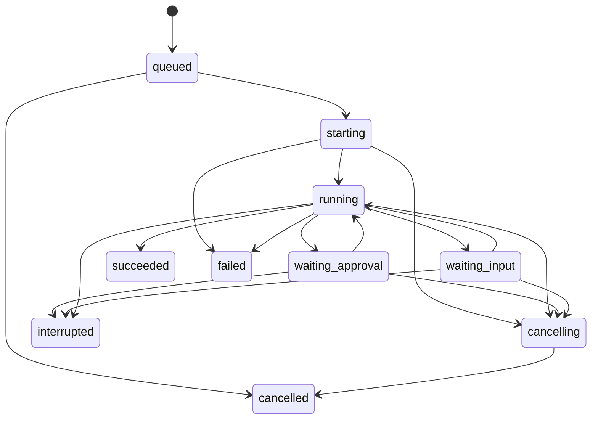

# 05 · 数据、命令、事件与一致性

## 1. 数据库是怎样的真相源

SQLite 保存身份、业务记录、会话 entries、运行日志、持久事件和后台队列。每个模块拥有自己的表，但跨模块的关键事实可以通过应用事务单元原子提交。例如接收用户消息时，同一事务创建输入记录、Run、去重命令结果与 outbox 事件；不能先告诉 UI 成功，再等异步监听器补建 Run。

采用 WAL、外键检查、短写事务与有界 busy timeout。Go 提供一个逻辑写入口；读取使用短快照事务。模型、网络、PTY 和大文件 I/O 永远在事务外。正式业务事务使用满足断电持久性目标的同步配置；首版选 `synchronous=FULL`，索引批处理允许独立配置。选择 SQLite 驱动时要检查实际链接的 SQLite 版本、FTS5 和备份能力，不能只看 Go 包版本。

采用“当前状态 + 必要追加历史 + outbox”，不把所有表都强制做成完整事件溯源。Run 状态和 planner 当前版本可以直接读取；Pi entries、工具操作、记忆 revision 和来源不能被静默覆盖。重建 UI 投影不依赖重放应用从安装以来的全部事件。

## 2. 存储对象和所有者

| 表组 | 关键事实 | 事务要求 |
|---|---|---|
| assistants / persona_versions / preferences | 稳定身份、用户选择的人格版本、显式设置 | 版本更新与通知同提交 |
| projects / sessions / branches | 项目范围、会话、分支头和写入租约 | claim/release 与 Run 状态一致 |
| messages / pi_entries | UI消息索引与原始Pi树 | 原始 payload、父节点、leaf、branch revision 一并提交 |
| runs / run_attempts / run_inputs | 逻辑工作、具体执行、排队或 steer 输入 | 状态转换 CAS，终态不可退回 running |
| tool_invocations / approvals | 实际执行意图、授权、结果与不确定性 | final args hash 绑定；外部副作用不包在长事务里 |
| domain_events / outbox / command_receipts | 已提交事实、分发状态、命令幂等回执 | 与业务写入在同一事务 |
| blobs / 内嵌SourceRef / derivations | 附件和有版本的证据 | blob 完整写入后才发布引用；删除跟踪派生依赖 |
| memory_slots / memories / memory_revisions / provenance / relations | 正式记忆与证据、冲突和替代 | CAS 发布、词法投影和索引队列同提交 |
| context_snapshots / context_manifests | 压缩覆盖和每次调用输入清单 | 与Pi压缩 entry的提交语义一致 |
| memory_eligible_events / consolidation_jobs / cursors | 可整理来源、批次与进度 | 成功发布与推进游标同提交 |
| planner_items / schedule_blocks / plan_drafts / reminder_rules / schedule_occurrences | 任务/日历真相、提醒定义和每次触发 | occurrence 唯一键防重复，提醒不修改任务完成 |
| terminal_sessions / execution_links / execution_observations | 外部现场、任务关联、可靠结果证据 | 进程退出与业务完成分字段 |
| attention_items / intentions / deliveries | 关注、行动判断、实际展示 | 事实版本复核和投递去重 |
| affect_state / affect_events | 当前心情、每次因果变化 | 原因去重、状态版本和事件同提交 |
| scope_epochs / erasure_rules / background_jobs | 范围变化、遗忘屏蔽、通用可恢复工作 | 删除立即不可见，清理允许异步 |
| capability_installations / model_catalog_snapshots / role_bindings | 已装能力及版本、模型目录快照和角色绑定 | 活动Run固定配置指纹，升级在安全边界生效 |

`checkpoint_receipts`与entry/leaf同事务保存attempt+batch_id、请求hash和原ack。重发先查回执再做revision CAS，避免ack丢失后同批被误拒绝或二次追加。`pi_entries.entry_ordinal`保存session内原始追加顺序，不能仅按parent或同批相同seq重建。

`contracts/storage.sql` 给出初始表和索引。记忆的scope+subject+slot由memory_slots唯一键和slot revision进行CAS，包含首次创建，防止两个会话用不同memory_id绕过冲突检查。整理发布同时校验cursor revision，同一scope/extractor最多一个running批次。

JSON 字段用来保存版本化 payload、配置和来源集合；经常用于过滤、排序、唯一性或关联的字段必须独立成列。未知 Pi entry 字段原样保存，不能为迎合简化 schema 丢掉提供商签名。

## 3. 标识、时间与版本

- 业务 ID 使用稳定随机 ID；不把可变标题、模型名字或文件路径当主键。
- `seq` 是 DB 分配的全局提交顺序号，协议中用十进制字符串，避免 JavaScript 整数精度损失。墙上时间仅用于展示和规则。
- `revision` 是单个聚合的 CAS 版本；`branch_generation` 表示历史路径变更；`worker_epoch` 表示进程代次；`fencing_token` 表示作业租约代次。四者不能互代。
- 时间点统一保存UTC `YYYY-MM-DDTHH:mm:ss.sssZ`（固定三位小数、24字符），所有入口先正规化再比较/排序；不得混存变长RFC3339Nano。日历日期保存 `YYYY-MM-DD` 加 IANA timezone。全天任务没有假造的零点 UTC deadline。
- ScheduleBlock的all_day或floating/zoned本地语义必须保留local_start/local_end；UTC起止仅作派生查询索引，不能反推改写用户日期。
- SourceRef 引用对象 ID、版本和 payload hash；文本跨度采用 UTF-8 字节半开区间。模型给出的 span 必须由宿主对原文重新核验。
- 普通 metadata 不能改变安全范围。RunScope 由 Go 构造并冻结；扩大范围依据用户的明确指令建立新scope版本的后续Run，不原地扩大正在执行Run的权限。

## 4. 命令与查询

所有写命令携带 `command_id`、调用方、`expected_revision?` 和类型化 payload。参数与命令摘要采用SHA-256加[RFC8785 JCS](https://www.rfc-editor.org/rfc/rfc8785)规范化JSON；拒绝非法数字和重复键，Go/TS使用相同fixture，未定义字段不能参与审批后偷改。checkpoint请求hash只含method、context、payload，不含会随重发变化的worker_seq。相同 command_id 与相同内容重试返回既有结果；相同 ID 但内容不同返回 `IDEMPOTENCY_CONFLICT`。UI 应在一次点击重试中复用 ID，用户真的再次发起工作则用新 ID。

| 领域 | 命令 | 查询 |
|---|---|---|
| 会话/运行 | `SubmitMessage`、`SteerRun`、`QueueFollowUp`、`CancelRun`、`RecoverRun`、`ForkBranch` | `GetSessionSnapshot`、`GetRun`、`ListRuns`、`GetContextManifest` |
| 工具 | `ResolveApproval`、`ReconcileInvocation` | `GetApproval`、`ListInvocations` |
| 记忆 | `ProposeMemory`、`PublishMemory`、`ForgetMemory` | `SearchMemory`、`GetMemoryProvenance` |
| 计划 | `UpsertPlannerItem`、`MarkTaskDone`、`SnoozeReminder`、`CommitWeekPlan` | `ListPlannerItems`、`PreviewWeekPlan` |
| 终端 | `LaunchExecutor`、`AttachTerminal`、`SendTerminalInput`、`StopExecutor` | `GetTerminalSnapshot`、`GetExecutionCapabilities` |
| 主动性 | `StopFollowing`、`RespondToIntention`、`AcknowledgeDelivery` | `ListAttention`、`ListPendingDeliveries` |
| 身份/情绪 | `UpdatePersona`、`SetInteractionMode`、`ResetAffect` | `GetIdentitySnapshot`、`GetAffectState` |
| 系统 | `EnableCapability`、`SetModelRole`、`ExportBackup` | `GetHealth`、`ListCapabilities`、`GetModelCatalog` |

查询分页以稳定 cursor，不以 offset 读取不断变化的聊天流。范围不合法返回 `SCOPE_DENIED`，不通过返回空字符串掩盖。命令接收成功和任务执行成功分开：SubmitMessage 返回 `run_id/status=queued`，后续用事件获知结果。

## 5. 持久事件与临时流

统一持久事件信封：`event_id, seq, event_type, aggregate_type, aggregate_id, aggregate_revision, occurred_at, committed_at, causation_id, correlation_id, assistant_id, scope, source_refs, payload_version, payload`。

事件举例：`run.queued`、`run.state_changed`、`tool.planned`、`tool.result_committed`、`message.committed`、`memory.published`、`planner.item_changed`、`execution.observed`、`attention.changed`、`affect.changed`、`delivery.presented`。不把每个 token delta 都写进 domain_events；delta 带 stream_id/chunk_index，最终消息替代未提交片段。

订阅流程是 `GetSnapshot → 得到 snapshot_cursor → Subscribe(after=snapshot_cursor)`。快照和 cursor 必须来自同一读事务，避免快照与订阅之间丢事件。重连后服务端按 cursor 补发；日志已压缩超出保留窗口时返回 `CURSOR_EXPIRED`，客户端重新获取快照。订阅过滤在 Go 执行，不能把其他项目事件先发到 UI 再过滤。

outbox 分发采用至少一次；消费端保存 `(consumer_id,event_id)` 或聚合 last_seq 去重。只保证同一聚合按 revision 生效，不依赖不同消费者“同时看到”某件事。一次通知已经呈现但客户端 ack 丢失时，用 delivery_id 复原卡片，不重播全套声音和探头动画。Delivery的事实键固定规则：回复使用result_ref/版本，提醒使用occurrence_id/snooze_generation，晨报使用report_key。普通dismiss不增加版本；用户明确snooze命令幂等增加snooze_generation，允许指定时间的新投递；重复同command不再增加。Delivery 按事实 ID/版本/用途去重，不能换 intention_id 重弹已收起事实；Affect 另有 assistant_id + cause_event_id + appraisal_kind 唯一约束。

## 6. Go ↔ Pi 协议约束

传输采用私有 stdio NDJSON，标准输出只允许协议帧，日志进标准错误。worker bootstrap在加载SDK与扩展前把console重定向到stderr；managed扩展不得直接写协议stdout。非协议或超限帧触发明确PROTOCOL_MISMATCH并中断对应attempt，不当成模型文字；trusted-native直接写stdout需适配或隔离通道。每帧最大 1 MiB；超出内容用 `blob_ref`，由宿主验证权限、长度和 hash。二进制图片不在 stdout 上无限 base64 扩张。工具与 worker 心跳、取消采用独立控制处理队列，长模型调用不能阻塞取消读取。

每帧携带 `protocol_version, kind, method, request_id, worker_id, epoch, worker_seq`；除worker.ready/health外必须携带context IDs，重复payload归属字段必须完全相等，否则拒绝。session.open在构造SDK前即提供AttemptLease和固定RuntimeConfigSnapshot，禁止SDK默认扫描用户全局Pi目录。run.start携带真实ContextPacket而非只有manifest引用；seed内容hash必须核对，最终每次模型请求另建ContextManifest。业务上下文使用 session/branch/run/attempt ID。checkpoint/compaction/context_repair成功只返回对应method的ack，失败用response(ok:false)，不得在ack前发另一个成功response。`ack` 专指所声明提交边界已经完成，不能把“读到了字节”作为已持久化确认。一般 response 的成功含义由 method 定义。

**所有跨进程效果都要有四个检查**：协议/格式版本支持；进程 epoch 仍当前；Run/attempt 仍持有该分支租约；command/invocation 没有已经处理。对于会被取消/遗忘影响的写入，再核对 scope/erase epoch。已知工具结果可以进入原 invocation 日志，即使取消同时发生；它不能把已取消 Run 改成 succeeded。

Go supervisor根据心跳和工作进展续租，fencing token只在owner代次变化时增加；客户端expires_at是快照，执行权以Go当前租约为准。worker退出、被取消或分支移交后立即撤销，不能因迟到心跳复活。

最初握手协商能力：SDK build、Pi entry format、支持的 compaction bridge、tool routing、扩展 UI、媒体类型和 model features。主协议 major 不匹配则拒绝启动；可选能力缺失只关闭相应功能，必须能在设置里解释。不同 schema 的 adapter 不能用同一缓存会话混跑。

每次真实provider请求，包括工具后续轮、自动重试和压缩摘要，都必须经过PiBridge的`model.request.prepare`：提供最终packet/blob引用与hash、当前canonical revision、工具表版本和requested model，Go校验完整配对/范围/预算、持久化本次ContextManifest与model_requests、分配网络额度后返回permit。`model.request.finish`报告真实usage/结果并释放额度。run.start的初始manifest不能代替所有后续调用的记录。直接调用外部模型的trusted-native扩展不属于该保证。认证由宿主按次发短作用域材料，永不落入manifest、回执或日志。

普通`session.checkpoint`拒绝新compaction和未经验证的context_edit；Bridge必须识别后走专用compaction_commit或session.context_repair_commit编辑路径。context_repair_commit首版只允许省略可证明失败的provider尝试，验证来源前缀、完整工具组及失败请求ID；不得移除用户输入、成功工具结果、未决审批或不确定副作用。原始payload继续保存；允许的context_edit、leaf和回执同事务提交，ack后才可继续。不具备这些前提的SDK自动修复路径禁用并转受控恢复Run。

## 7. Run 状态机

图省略了宿主崩溃时 starting/cancelling 进入 interrupted，以及审批明确拒绝后生成受控工具拒绝结果、由 Pi 继续解释的路径。实际转换表必须在 reducer 中集中定义；`succeeded/failed/cancelled/interrupted` 为终态。恢复通过新 Run 的 `recovery_of_run_id` 关联原 Run。

`phase=thinking/tool/compacting/idle` 用于显示内部进度。`waiting_approval` 是正式状态；“正在执行工具”和“模型正在回复”不是两个可同时覆盖 run.status 的来源。Run状态由全部活动请求、invocation和UI等待项聚合计算，不能由最后一个工具回调覆盖。仍有可推进工作时保持running并附pending提示；只有剩余进度确实被用户输入阻塞才进入waiting_approval/waiting_input。一个Run可以成功回答“工具被拒绝了”，而对应业务任务仍未完成。

## 8. 工具操作与审批

Invocation 状态固定为 `planned/awaiting_approval/executing/succeeded/failed/cancelled/denied/outcome_unknown`。先记录工具意图和最终参数 hash，再调用执行器，再记录结果；这个顺序解决“发生了什么”的可解释性，不创造外部系统的 exactly-once 保证。

审批记录绑定最终 args hash、工具版本、policy revision、workspace 和前提资源 revision。`ResolveApproval` 必须对当前 pending 记录 CAS，过期、重复、参数变动都返回明确结果；批准只允许该绑定动作。已拒绝的审批不被后台重试变成新批准。等待窗口关闭不等于用户同意。

本地有事务能力的领域操作使用 invocation_id 做幂等键；外部 API 若支持幂等键则透传稳定键；文件写可使用预期文件 hash 和原子替换；无幂等且执行结果不明的操作进入 reconciliation。read-only 自动重试与写操作重试分别配置。模型最多提出重试建议，不能绕过 outcome_unknown 决定直接再做一次。

## 9. 时间、日历与定时器

Scheduler 将规则编译成下一次 occurrence，保存 `rule_id + recurrence_key` 唯一键。每次触发在事务中 claim occurrence 并产生任务/投递；进程被暂停、系统休眠和重启不会使同一个 occurrence 多次生效。

任务期限与提醒分开：“周五前做完”写入 due_date 或明确 due_at，不自动等价于一个提醒；“明天上午九点提醒”另建 ReminderRule，记录解析时使用的时区与本地时间。ScheduleBlock 只管排期，拖动不改期限，snooze 不改排期。DST 重复时间首次触发，跳过时间默认移到下一个有效时刻，策略在 rule 中保存；不让模型每次重解释同一句已确认规则。

错过提醒按规则处理：一次性明确提醒默认在恢复后的有效宽限期内补一条，过期显示到工作区；晨报当天补一份；高频扫描不逐次补放；任务截止事实始终留在 planner。时间绑定另设 floating_local / zoned_local / absolute_instant：用户时区变更只让 floating_local 跟随，zoned_local 保持原 IANA 时区，absolute_instant 保持时间点；重新计算相应未来 occurrence，不更改已发生记录。使用单调时钟计运行间隔，墙上时钟计算日程，时间回拨不得导致负延迟或重复触发。

## 10. 子任务委派

Chela 可以为受控研究、整理或验证创建 child Run：同一 assistant_id，独立内部会话、来源父 Run、显式输入包和输出 schema。子任务只获得父 scope、工具权限和预算的子集；不复制所有记忆、全部聊天或所有凭据。结果是带证据的交付记录，父 Run 决定如何用于回答；子任务不能直接抢占用户当前聊天窗口。

首版最大委派深度 1，每父 Run 最多同时 2 个 child，仍受全局并发限制。为避免所有 worker 都在等子任务而死锁，调度器只在存在可用 child 额度时原子接纳委派；没有额度就返回 `DELEGATION_CAPACITY`，父模型自行顺序完成或缩减任务，不能持有父 worker 并无限排队等待不可获得的子 worker。委派是编排操作，父等待时不得持有child需要的workspace/file锁或工具执行permit；批量接纳须原子预留整批worker与lane额度，不足整体拒绝，启动失败释放预留。父取消默认取消自己创建且未被用户接管的子 Run；外部用户独立启动的终端不随之被杀。

这不是额外智能框架。所有 child Run 使用相同 PiBridge、审批、日志、预算和恢复协议，只改变输入范围与结果归属。

## 11. 统一错误语义

`DomainError` 包含稳定 code、给用户的 message、retryable、retry_after_ms、correlation_id 和可选安全 details_ref。最低代码集：`INVALID_ARGUMENT`、`REVISION_CONFLICT`、`IDEMPOTENCY_CONFLICT`、`SCOPE_DENIED`、`APPROVAL_REQUIRED`、`APPROVAL_EXPIRED`、`CANCELLED`、`DEADLINE_EXCEEDED`、`CAPACITY_EXHAUSTED`、`MODEL_UNAVAILABLE`、`CONTEXT_TOO_LARGE`、`PROTOCOL_MISMATCH`、`STALE_EPOCH`、`STALE_LEASE`、`OUTCOME_UNKNOWN`、`CURSOR_EXPIRED`、`STORAGE_UNAVAILABLE`、`DELEGATION_CAPACITY`。

重试决策取决于操作语义和已提交阶段，不只取决于 retryable。数据库写入失败后不得向 UI 发已成功事件；诊断系统失败则不反过来撤销已经成功的业务事务。
