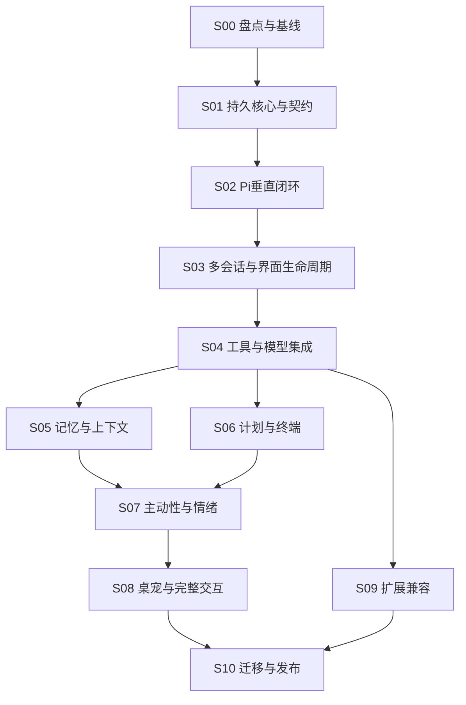

# 实施计划 · 从当前 Chela 安全迁移到目标架构

本计划覆盖完整目标，不把主动性、跨会话情绪或记忆连续性降为不确定的“以后再做”。阶段划分用于建立可验证依赖，最终完成标准是所有核心场景成立。每阶段交付可运行的纵向能力；不能只新增接口、空服务和一批 TODO 就宣称完成。

## 1. 执行规则

1. 从用户当前工作区开始，保留未提交修改和已做的新 Go 工作；远端旧 main 只是迁移参考。
2. 阅读本包后直接执行 S00，不重新进行一轮抽象架构头脑风暴。明确用户意图已经固定的选择由实现者落实。
3. 每阶段先读涉及的现有实现和 AGENTS 说明，再以最小必要变更完成行为。不要因目录命名不同而整仓搬迁。
4. 核心协议字段、枚举与数据所有权改变时，同一改动更新 contracts、调用端、迁移和对应测试。
5. 每阶段报告：已得到的用户行为、修改入口、真实验证证据、具体剩余问题。未执行的测试直说，不能把静态review写成跑通。
6. 非阻塞实现细节自行判断；权限已明确的常规操作继续进行。只有实质产品冲突、缺失必要访问或无法安全判断的真实数据修改才提出具体问题。

## 2. 阶段依赖

S05 与 S06 在契约冻结后可并行；S08 的视觉实现可提前做静态组件，但完整行为依赖 S07。S09 先完成必要的基础插件宿主，广泛兼容测试可并行推进。任何关键上游门禁失败先修复边界，不能让几轮功能堆在不可靠基础上。

## S00 · 实际工作区与旧能力盘点

**操作**：识别仓库、当前分支、dirty文件、已有Go/MyGo/worker目录、旧Electron归档和数据目录。只读检查实际 Magpie 接口、Figma可用资源、Pi依赖、MCP/skills、Codex/OpenCode安装与平台支持。用现有脚本尝试baseline build或最小smoke；记录失败原因，不顺手重装或清空环境。

**产物**：一页当前状态与目标模块映射、功能迁移表、dependency manifest、用户数据备份/计数/hash清单，以及分阶段工作分支。用户的本地分支优先于远端旧证据；现有可用能力列为回归基线。

**门禁**：能指出内部Agent入口、真实状态存储、UI桥、终端入口；每个旧能力有明确迁移去向；未知来源记录未被自动全球化。A31、A32、A34的准备部分。

## S01 · 持久核心与唯一契约

**操作**：建立应用 supervisor、服务依赖图、SQLite repository与短事务单元、command receipts、domain events/outbox、scope、clock与ID接口。按实际数据制定migration，而非直接覆盖库。建立Go/TS协议生成或共享fixtures，定义合法状态转换。

**产物**：无模型也能创建会话/任务、提交queued Run、查询快照、订阅增量、重复提交去重；应用重新打开保留这些事实。生成bindings的命令不启动真实服务。

**门禁**：DB事务回滚不发成功事件；重复command不建第二Run；每分支独占writer；快照/cursor无订阅空隙；schema与类型校验通过。A05、A06、A42、A45的基础部分。

## S02 · PiBridge 的最小完整闭环

**操作**：打包私有Node worker，嵌入AgentSession；显式配置model/resource/settings/paths；建立SessionManager内存投影、原始entry持久化、请求/事件IPC、host commit barrier。先做一个read工具和一个有副作用的受控本地测试工具，证明调用只走Go网关。

**产物**：用户发消息→Go持久化→Pi推理→工具→结果提交→最终消息；退出重启可重建历史；阶段内也要证明工具批次、custom entry、compaction路径和最终settled处理。

**门禁**：延迟/拒绝checkpoint时工具不能提前执行；worker crash后已知结果不重复；未配对tool calls不送provider；公开session.subscribe不能冒充awaited barrier；stdout污染明确中断；Pi自动重试不提前结束Run。A09–A12、A42。

**失败处理**：若选定SDK版本没有可验证适配点，定位具体路径并在版本化PiBridge内修复/约束，必要时使用有来源的最小adapter补丁；不能增加第二个Agent loop或第二套session文件绕过问题。补丁必须有升级时会失败的兼容测试。

## S03 · 多会话、队列与窗口生命周期

**操作**：单assistant、多session/branch、Go后续输入队列、显式steer、worker pool与lane；UI输入、流式、取消、恢复、分支操作；关闭视图与应用Run解耦。隐藏internal session供后台和child使用。

**产物**：两个会话并行，A取消不影响B；切页仍连续；进程恢复能看见中断原因；同分支follow-up按顺序执行，不双入Pi队列；关主窗口保留后台。

**门禁**：A01–A08、A35基础；检查cwd/工具/审批/取消/输出都显式带IDs。并行工具状态聚合正确，父子资源等待不死锁。

## S04 · ToolGateway、模型与系统能力

**操作**：迁移旧policy/approval/invocation记录，final args再次校验与hash，资源锁与取消，outcome_unknown reconciliation；MagpieAdapter、role bindings、能力检查、usage与预算；先迁移现有最常用工具，不顺手扩大监控范围。

**产物**：工具有可解释的权限和回执；参数变化使旧审批失效；真实模型选择可见；离线仍能使用本地能力；安全恢复提示带已知/未知动作列表。

**门禁**：A10–A12、A37–A38、A42–A43。managed与trusted-native标记真实；文件/外部副作用无盲目重放。

## S05 · 长期记忆、上下文与空闲整理

**操作**：先做正式记忆/来源/范围/纠错/遗忘，再做词法和向量；统一ContextManifest/token budget；接入唯一Pi compaction与SafeCut事务；最后加入eligible queue、batch lease、fencing和游标提交。

**产物**：换会话仍记得适用偏好；能解释记忆来源、纠正、忘记；项目不会串资料；长对话连续；空闲时整理，前台可打断；embedding失败不丢内容。

**门禁**：A13–A18、A33。中文短词、不同embedding空间、compaction tail追加/旧前缀编辑、ack丢失、整理资格游标、删除复活都要实测。

## S06 · 任务、备忘录、日历与外部现场

**操作**：迁移note/todo及旧execution字段；统一PlannerItem/ScheduleBlock/Reminder；实现轻量周计划草稿与提交；Codex/OpenCode adapter按实际能力flags接入PTY/结构化回执/恢复。保留旧xterm/PTY能力直到替代验证。

**产物**：一条任务在列表/日历/看板一致；笔记可读可编辑；任务排期、期限、提醒分别修改；点新回复回原终端；用户可以看完后自己标完成；无强制验收表。

**门禁**：A26–A30、A31对应条目。终端退出、聚焦、文字“完成”都不能触发task.done；时区/DST/snooze/catch-up符合规则。

## S07 · 关注、主动性与全局情绪

**操作**：先做Attention/Intention/Delivery持久状态与确定性条件，再接低预算Pi判断；实现免打扰、去重、过期复核、晨报；实现Persona/InteractionMode/Affect分离、评估提议、accepted_seq reducer、衰减、混合情绪和表达上下文。

**产物**：没新消息时仍会关注已授权事项；没变化时模型调用为零；结果合适时出现；A里的轻松互动能带到B的神态，严肃工作仍正常完成；重启心情随时间回落。

**门禁**：A19–A25、A28晨报。自发预算耗尽不阻塞明确提醒；重复事件不反复加分；系统自身事件不触发自激循环；关闭气泡不绕过去重重弹。

## S08 · 独立桌宠与完整用户流程

**操作**：依现有Figma实现PetSurface、表情资源和本地动画；Presentation Coordinator串行仲裁；与任务/终端/会话route关联；完善键盘、IME、拖拽、滚动、无障碍和减少动态效果。

**产物**：独立小圆脸、靠边探头、思考/说话/休息等动作；多Run不抢表情；关闭主窗口继续，隐藏桌宠仅关闭该surface；普通提示不抢焦点。

**门禁**：A35–A36，以及跨会话、原现场返回、免打扰三条完整端到端流程。在目标平台记录真实截图/视频或人工操作结果，不拿静态图代替行为验证。

## S09 · 扩展生态与模块化增长

**操作**：能力manifest/依赖/lifecycle、Pi A–E兼容矩阵、UI桥、skill来源作用域、MCP唯一owner、延迟工具发现；安装/启停/重载在安全边界发生。整理旧插件去向。

**产物**：支持的Pi扩展确实可用；TUI-only明确标需适配；官方managed能力真实走网关；第三方native边界可见；失败插件不拖垮其他服务。

**门禁**：A39–A41；测试重复注册、残留订阅、console污染、嵌套调用、旧包alias、custom entry恢复和同worker跨会话状态。没有测试证据的兼容项不得打勾。

## S10 · 全量迁移、故障演练与发布

**操作**：真实数据dry-run与对账、增量/一次性导入、切读路径；执行A01–A46剩余场景；性能测量与预算调整；安装/更新/备份/恢复；确认数据删除传播。

**产物**：可安装完整版本、固定依赖清单、数据迁移报告、已知限制与回退路径。所有旧功能都有保留、替代或明确产品决定，不能无声消失。

**门禁**：A31–A34、A42–A46及完整验收矩阵。未知本地工作区变更已吸收；程序退出后不会声称继续运行；性能/内存只报告实测。

## 3. 可以并行的工作与文件所有权

| 工作流 | 主要目录 | 依赖 |
|---|---|---|
| Go持久核心/调度/策略 | internal/domain、adapters/sqlite | S01先冻结契约 |
| PiBridge/扩展宿主 | worker、adapters/pi | 与S02共享fixtures，不私改协议 |
| React/MyGo界面 | web、transport/mygo、platform | 使用生成客户端和mock快照 |
| 记忆/主动性领域 | 对应domain模块 | 复用统一事件/事务/Run接口 |
| PTY/外部执行器 | adapters/executors | 独立capability flags与回执fixtures |

同一时间只有一个集成人负责修改contracts和schema版本；其他任务提出具体变更。避免多人同时改总调度器、根store或同一migration。每个并行任务以可验证模块和场景交付，不分裂成各自一套事件bus/配置库/Agent循环。

## 4. 最终完成定义

完成不以代码行数、模块数或所有TODO被删为准。必须能演示：同一个Chela在多个会话持续存在；并发隔离正确；记忆有来源且可纠正遗忘；长对话压缩可靠；后台会关注变化；心情连续且表达得体；任务与原终端现场关联；桌宠独立行动；应用重启、依赖失败和升级都有准确状态。交付时附已执行场景、失败/跳过的具体原因、运行命令和剩余限制。
