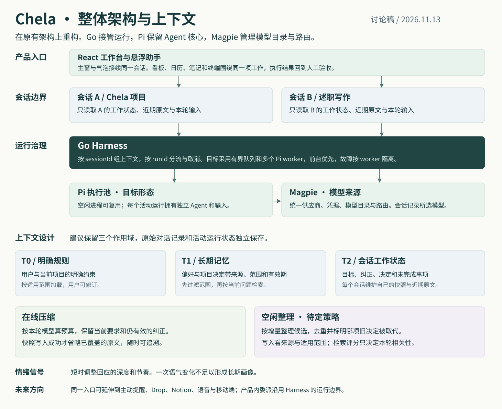
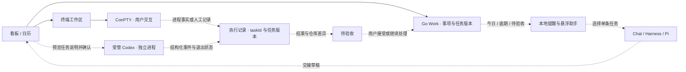
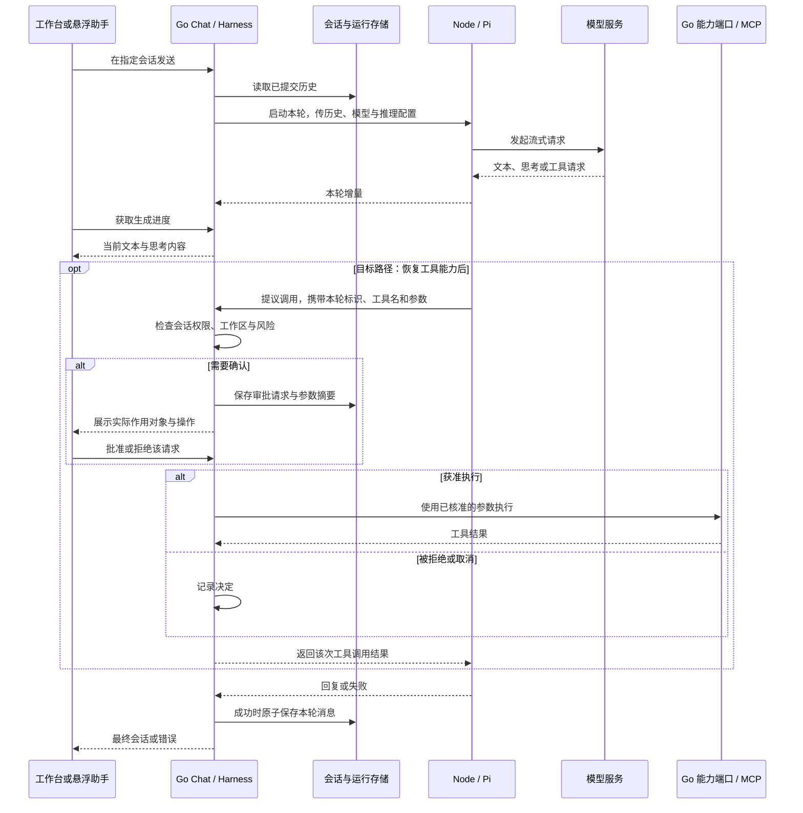
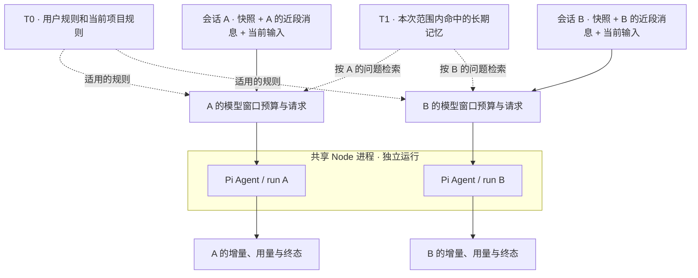

# Chela 整体架构

2026-11-15 更新。重建的目标与验收采用 [架构包 v1](chela-architecture-v1/README.md)，实施基线见 [实际工作区盘点](../migration/workspace-baseline.md)。Chela 的稳定身份、人格和持续心情由后台统一维护，多会话保有各自的工作上下文、工具、审批和取消归属。下文记录此前实现与讨论，具体设计以 v1 契约为准。

**2026-11-13 · Windows 桌面工作台与个人助手**

[打开讨论版矢量图](chela-system.svg)

**本轮明确的方向。** 保留已有 Chela 的产品行为与 Pi 核心，从原来的 Node 管理层向 Go 迁移。Go 负责本机运行和资源治理，Pi 负责 Agent 循环，Magpie 统一提供模型目录、凭据与路由。Chela 记录每个会话实际使用的模型。

**上下文与并发。** 每个会话独立拥有历史、快照和当前目标，每次运行独立组装输入。讨论中的方案是由 Go 调度有界的 Pi worker 池，区分前台对话和后台整理，限制积压请求和单次故障的影响范围。池大小、排队方式与多窗口交互仍待确定。

**记忆与反馈。** T0 明确规则、T1 长期记忆、T2 会话工作状态是当前候选划分。在线压缩保留原文、快照覆盖位置和仍有效的纠正。空闲整理可按增量合并重复记录、标注被替代的决定；情绪信号先用于当轮回应。记忆写入资格与检索相关性分别判断，具体信号、阈值和整理时机尚未定案。

下面保留此前的实现与迁移对照，描述的是讨论时的代码基线。最新目标以上图和本节为准。

## 从产品入口看后台

| 用户动作 | 当前 Go 版的路径 | 旧行为与目标 |
|---|---|---|
| 主窗聊天、停止、再次发送 | WebView2 → MyGo → Go Chat → Pi → 模型；流式增量回到 Go，页面通过 Progress 读取，成功终态写入会话文件。Vite 开发页经同源端点和 chat-dev 进入相同服务。 | 恢复草稿、附件、消息编辑重试、队列、失败与中断记录时，沿用原会话语义。分别验证“历史可读”和“中断的工作可继续”。 |
| 悬浮助手处理今日事项 | 新壳当前提供主窗五个工作区。旧 Electron 已有独立悬浮窗口、气泡对话与主窗接续。 | 边缘悬停或提醒时唤出，可固定聊天；主窗和气泡引用同一会话。锁屏时隐藏内容，后台保留草稿和活动运行，明确退出时收尾。造型、动效与后台行为分别验收。 |
| 在看板建事项、在日历改日期、写笔记 | 看板和日历共用 WorkTask；WorkNote 有独立 ID 和版本检查。桌面通过 Go Work 写入 work.json，浏览器预览使用标签页数据。 | 从一条已选事项生成交接说明。定时提醒在本机按日期、时区和去重规则工作，无须启动 Pi。记录提醒、事项完成、会话内步骤清单三类状态。 |
| 在项目目录启动外部执行者 | 终端页面 → Go Terminal → Windows ConPTY → pwsh、Codex 或 OpenCode。终端可带 taskId，切回页面按输出偏移重连。 | 普通 PTY 提供交互现场；受管 Codex 另走结构化执行接口，保存运行结果与任务版本。成功进入待验收，任务完成由用户确认。 |
| 看仓库改动、把页面元素交给助手 | 新壳已能关联项目目录。旧版有 Git/diff、Browser Preview、DOM 选择和附件上下文的代码。 | 本地服务读取仓库状态，UI 展示变更。浏览器采集用户选中的元素，带页面来源交给 Context Engine。仓库的既有差异与本轮执行结果分别呈现。 |

[新壳入口](../../native/main.go) · [工作区路由](../../native/frontend/src/app/shell.tsx) · [前端桥接](../../native/frontend/src/platform/bridge.ts) · [Chat](../../native/internal/chat/chat.go) · [Work](../../native/internal/work/work.go) · [Terminal](../../native/internal/terminal/terminal.go) · [旧工作台交接与验收语义](../../history/electron/docs/plans/2026-11-06-personal-assistant-workbench.md)

下面用同一条事项说明内置助手和外部执行者如何协作。实线表示新壳已接入的工作区路径，虚线表示要从旧版接回的业务行为。

## 一轮模型调用与一次工具调用

**当前执行边界。** 每个 Chat 服务按需持有 Pi worker。一次发送使用独立的 Agent、取消信号和请求标识，会话的权威历史仍在 Go。进程复用省掉后续轮次的 Node 启动和 SDK 加载；本轮仍会传入整段历史，长会话的序列化与模型侧上下文成本要单独测。Pi 的工具列表当前为空。上图带“目标路径”的部分是原 Harness 迁回 Go 后的协议。[Go 与 Pi 的边界](../../native/internal/chat/pi.go) · [Pi 主循环](../../native/agent/chat.mjs) · [旧 Harness 门控](../../history/electron/src/main/harness/tool-execution.ts)

**取消的范围。** 正常停止按 runId 中止单轮。同一 worker 中的 SDK 或管道卡住、取消超过 2 秒时，Go 会回收整个进程，其他仍在运行的会话也会收到失败。后续显式发送时重建 worker，保留已提交会话历史。[取消处理](../../native/internal/chat/pi.go) · [进程回收](../../native/internal/chat/pi_worker.go)

**失败和恢复。** 当前成功回复与用户消息一起提交；发送失败时调用方收到错误，活动 run 尚缺持久化日志。下一轮迁移采用旧版的事件顺序：先记用户输入与运行开始，再记审批和终态，最后刷新 UI 投影。提交过的事件应能按 run 和事件标识去重。主机重启时，遗留活动 run 标成中断；原审批可关联到新的恢复 run，执行前重新核准。工具在断电前是否已经产生副作用须由该工具的结果或幂等契约确认。[旧会话写入顺序](../../history/electron/src/main/session/transcript-writer.ts) · [旧运行与审批](../../history/electron/src/main/harness/runtime.ts) · [个人 Harness 演进](../../history/electron/docs/plans/2026-11-06-personal-agent-harness.md)

## 多会话与上下文工程

**当前主链。** Go 用 sessionId 找到该会话的文件，同一会话同时只接受一次生成，其他会话可以并行。发送时 Go 取出已提交的历史，加上这次用户输入，传给共享 worker。Node 为本次请求新建 Pi Agent，使用这次选择的模型、推理强度和独立消息数组。Go 按 runId 接收返回事件，再核对是否仍是该会话的这次生成才更新增量。单个会话空闲时只需要磁盘记录，无须单独保留一个 Node 进程。[并发入口](../../native/internal/chat/chat.go) · [事件分流](../../native/internal/chat/pi.go) · [Pi 请求组装](../../native/agent/chat.mjs)

页面目前用一个 pending 和一个全局操作标志，轮询当前发送中的会话。目标是把草稿、增量、停止和终态按 sessionId / runId 存放，选中哪个会话只决定展示哪份数据。回到页面或打开第二个窗口时，从 Go 查询对应的活动运行和已提交记录。服务端已验证不同会话并行；同一主窗的多会话操作及重连仍待接入。[现有聊天页面](../../native/frontend/src/workspaces/chat/chat-workspace.tsx)

**目标请求组成。** Go 为指定会话固定本轮工作区、模型、工具权限和 transcript 截止位置。Context Engine 取适用的 T0 规则、与本轮相关且可见的 T1 记忆、仅属于本会话的 T2 快照和近段记录，再加入本轮输入与用户选中的附件。Pi 负责转换成供应商需要的消息格式。新建会话从空的 T2 开始；同一项目可以读同一份项目规则。跨会话引用旧任务时，显式选取来源会话或交接摘要。个人通用偏好可以跨会话检索，项目事实限于该项目。上述作用域是新架构的设计约束，当前原生入口只接了文本历史和预算裁剪。

**预算与压缩。** 每个 run 根据实际选中的模型分别算预算。当前变换按窗口的 70% 估算历史预算，保护最近 6 个用户轮次；这不是精确 tokenizer，也不能保证一条超长输入一定放得下。当前缺少旧版的快照覆盖回调，早期消息可能仍在磁盘却已经退出模型视野。迁移后，先为系统规则、工具定义和输出预留空间，再选择可裁剪的历史；压缩产生带会话 ID、版本和覆盖序号的快照，持久化成功才省略已覆盖的前缀。若摘要失败或受保护内容单独就超窗，应返回可处理的上下文错误，避免静默丢掉用户要求。[当前裁剪逻辑](../../native/agent/budget-transform.ts) · [旧覆盖检查](../../history/electron/src/main/context/budget.ts) · [旧快照实现](../../history/electron/src/main/context/snapshot.ts)

**验收依据。** 同时给 A、B 不同的标记，核对模型端实际收到的消息、两个增量流、停止 A 后 B 的终态及各自存档。迁移快照后再测“小窗口 A 触发压缩、大窗口 B 继续”；重启后 A 的约束来自自己的快照，B 的快照版本和历史不变。另测两个窗口同时向同一会话发送，Go 应接受其中一轮并向另一方返回忙状态。

## 数据的权威来源

| 对象 | 当前实现与迁移边界 | 写入与读取规则 |
|---|---|---|
| 会话与 transcript | Go 已按会话存 JSON，从新壳早期总表或旧 Electron 的消息事件导入。原文件保留。列表接口目前仍读全量会话。 | 单会话更新只写该会话。旧总表所有会话导入成功后才发布新目录。旧 Electron 导入是文字投影，附件、快照、草稿和完整事件语义仍待迁移。 |
| 活动 run 与审批 | Go 当前持有活动请求；旧版有运行状态机、中断审批和审计记录。 | 运行状态回答“这次执行到了哪里”。持久化审批绑定 run、请求 ID 和已核准参数。停止、重复响应、写入失败、重启分别有终态。 |
| 会话上下文与长期记忆 | 新版复用旧预算裁剪与循环保护。目标沿用 T0 的 SOUL/USER/AGENTS，T1 的长期记忆，T2 的近段 transcript 与会话快照。 | Context Engine 选择真正进入模型请求的内容。裁剪前确认快照覆盖位置；长期记忆独立提取、检索、纠正和删除。旧版已有本地检索和 embedding 管线。 |
| 事项、执行与验收 | 当前 Work 保存事项与笔记，Terminal 持有本次启动的终端进程和有界输出。旧 planner 还保存执行历史、状态来源和人工验收。 | 一个 taskId 可对应多次执行。旧结果挂在原任务版本；任务内容已编辑时保留结果，重新判断是否推进。确定性业务动作由 Go 校验和提交，助手通过同一服务发命令。 |
| 配置与凭据 | 用户配置包含模型来源、条目、默认路由。新录入的秘密由 Windows DPAPI 保护；旧 Electron safeStorage 密钥需要重新录入。 | Go 为当前模型请求选路和取凭据，Pi 负责适配协议。UI 使用模型描述和状态，诊断记录过滤凭据与原始载荷。 |
| 可观测性 | 旧版已有事件分发、readiness 记录与离线报告。新版待接入。 | 从运行端生成结构化事件，分发至脱敏证据与诊断视图，sink 故障只降低观测健康度。离线评估消费证据生成报告；在线策略仍由确定性代码决定。 |

[新会话存储](../../native/internal/chat/sessions.go) · [旧事件导入](../../native/internal/chat/legacy.go) · [模型配置](../../native/internal/chat/models.go) · [旧 Context Engine](../../history/electron/src/main/context/engine.ts) · [旧记忆规格](../../history/electron/specs/07-memory-architecture.md) · [旧观测分发](../../history/electron/src/main/observability/dispatcher.ts)

## 文档里约定的未来方向

| 方向与原文状态 | 接在哪里 | 开始实施时的第一条可验证行为 |
|---|---|---|
| **桌面个人助手是核心入口**。旧工作台已实现过文字气泡、悬停、相关任务提醒和后台关闭选择。语音和移动端留待后续。 | MyGo 的窗口生命周期、同一 Chat 会话与 Work 服务。设置层承接本地外观、启动图和加载文字。 | 气泡发起对话后可到主窗接续；隐藏主窗后提醒仍能工作；明确退出时释放资源。 |
| **主动协助和外部执行**。旧版有整理今日、梳理选中任务、确认后新增待办和受管 Codex。自动分派、跨工具统一状态属后续。 | 本地提醒 → 选中事项 → 助手草稿 → 用户发起执行 → 结果回收。定时调度、持续目标、单次模型运行各有生命周期。 | 同一项执行完显示待验收；没有结构化结果时显示未知或人工记录。指定类别经持续授权后才能自动启动。 |
| **Drop 翻译**。已记录的触发约定，模型选型待评估。 | 悬浮入口 → 本地去重和意图规则 → 必要时请求获授权的意图分类 → 单独生成译文。 | 有新复制文本且主动停留才进入判断；普通复制不触发请求。图片解释、语音、跨应用选词分别决定授权范围。 |
| **Notion 和其他适配器**。先记录任务来源，随后评估指定数据库。Telegram、移动端是候选入口。 | Work 服务承接外部记录 ID、来源、版本和冲突处理；新入口复用应用命令与审批。 | 先读取选定记录再显式回写，区分本地验收状态与远端状态。 |
| **产品内子 Agent 与 Plan mode**。旧版有模型角色和后台运行类型，完整父子委派仍属规划。 | 父 Harness 分配子 run、输入范围和独立权限，传播取消、回收结果。轻量模型预处理工具输出可作为一个受限子任务。 | 子 run 只收到获准上下文；父 run 取消时能停止关联工作；返回产物由父 run 复核。外部 CLI 走任务执行记录。 |
| **记忆信号与 RAG**。旧本地 RAG 有代码；偏好观察、显式标记、反复纠正、预测偏差和动态检索属于后续设计。 | 运行与用户反馈生成候选，记忆系统负责来源、去重、置信度和撤销。Nowledge Mem 是旧提案中的候选后端。 | 验证用户明确记住与删除一条偏好后，下一次真正发给模型的上下文随之改变。 |
| **开放能力与运行分析**。旧版有事件总线、调度、Webhook、插件清单，以及部分工作流原语。 | 插件、连接器与 MCP 在授权边界后注册能力。脱敏事件可送本地离线评估；AI Judge 仅辅助解释失败。 | 先贯通一个可撤销的能力及一条审计路径；报告读取脱敏记录，分析组件离线时仍可正常聊天。 |
| **浏览器与仓库协作**。旧版有右侧 Browser、DOM Inspector 和 Git/diff 实现，新版待移植。 | 工作区 UI → 安全浏览容器 / Go 仓库服务 → 用户选择的材料 → 会话上下文。 | 选中的元素能追溯页面来源，显示当前仓库差异与可用的执行前基线；多人同时修改的内容无法可靠归因给单项任务。 |

方向来自 [个人助手工作台方案，尤其第 6、20、21 节](../../history/electron/docs/plans/2026-11-06-personal-assistant-workbench.md)、[个人 Harness 方案](../../history/electron/docs/plans/2026-11-06-personal-agent-harness.md)、[Drop 与启动画面待办](../../history/electron/docs/todos/2026-11-06.md)、[记忆信号提案](../../history/electron/docs/todos/memory-system-signal-driven.md)、[RAG 升级讨论](../../history/electron/docs/memory-rag-upgrade-spec.md)、[扩展与远期方向](../../history/electron/specs/README.md)和[离线分析边界](../../history/electron/docs/harness/chela-runtime-analysis-layers.md)。旧待办与源码进度有出入的地方，以上表的具体行为和源码为准。

旧版的 readiness 记录由事件总线经 ObservabilityDispatcher 送到 recorder，TraceService 独立订阅运行事件。已有插件清单扫描和启停入口，工作流执行原语与外部 API 适配器仍需接入产品主链。离线报告可以继续用现有 TypeScript；新 Go 宿主只需要履行运行时与脱敏事件契约。[Readiness 装配](../../history/electron/src/main/harness-readiness/service.ts) · [TraceService](../../history/electron/src/main/trace/service.ts) · [插件管理](../../history/electron/src/main/plugins/service.ts)

## 建议的迁移顺序

1. **宿主与会话。** 让 Go 回收进程、分流并发请求、隔离取消。用同一组输入验证进程复用前后的首段延迟、崩溃后的重连及旧记录导入。这是本轮实现范围。
2. **运行、审批与记录一起迁。** 选一个旧的有副作用工作流，例如助手申请新增一条待办。把“拒绝、批准、重启后重新确认、只写一条”从 UI 一直验到落盘。再沿相同路径迁文件工具与 MCP。
3. **恢复上下文。** 先接 T0 与 T2 的快照覆盖，再接 T1 检索；以实际发出的请求验证长会话、模型切换及压缩失败后的接续。用旧 fixtures 对照读取与恢复行为。
4. **接回个人工作台。** 悬浮助手、提醒、受管执行和验收使用同一组 Chat / Work 服务。按真实交互迁移后台驻留、任务版本、Diff 和选中材料。其余未来能力按上表的产品需求接入。

Go 原生模型库是可替换 Pi 的备选。进入替换评估时，对同一组实际网关验证文本流、推理、工具参数、取消和失败事件，并单独测本机资源与延迟。当前决定保留 Pi 的兼容层。
