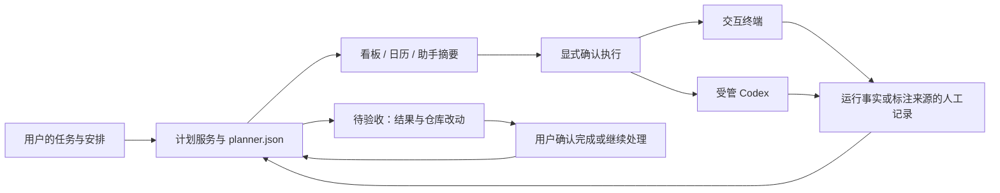

# Chela 个人助手与工作台方案 v0.1

更新时间：2026-11-07，业务收尾后更新。
状态：核心业务链路已有实现及此前的隔离验证；产品仍在完善中，不能据此视为整体验收完成。按用户最新纠正，先补齐关闭选择、执行状态保护和删除版本校验，再更新文档。本轮没有继续测试、构建或桌面验收，后续 UI 由用户完善。当前交接以第 20–21 节为准，第 10–19 节保留阶段事实。

## 实施补充：桌面助手是核心入口

后续用户修正（本节优先于早期形态描述）：形象和气泡不常驻显示，只有悬停唤出区域或主动提醒时出现；形象可采用 NOMI 式的简洁表情/颜文字，语音继续延期。用户明确要求参考本地 `D:/git-hub/Edge-Drop` 的边缘唤出方式。当前已将小透明窗口改为完整尺寸窗口，收起时鼠标穿透，由主进程轮询屏幕边缘位置，停留后展开、移出后收起；点击固定后的文字交互保留。窗口表现和视觉细节仍待完善，本轮不再继续修改 UI。

用户明确：关键是悬浮展示而非 Drop 操作。主窗口未打开时，桌面上的形象就是助手的窗口。第一版使用原创形象与文字气泡，语音后续再做。解锁后可主动展开，称呼“老大”，根据真实计划整理今日、逾期及待验收事项；同日重复解锁不重复完整问候。支持主动展开、收起、免打扰及进入看板/日历/助手。锁屏时隐藏内容，不因普通复制读取或外发剪贴板。

这项能力与原方案一起实施，不替代看板、日历、终端和任务关联。主窗口关闭到后台时保留活动终端与草稿；明确提供退出应用入口。退出或重启不承诺 PTY 恢复。

## 1. 产品定位与已明确的方向

Chela 是围绕使用者长期生长的个人助手，也是个人工具、工作习惯和实践成果的积累载体。真实需求足以成为添加功能的理由，不以商业化、通用用户覆盖或追赶外部框架为前提。

- 保留自己的 Agent 和 Harness，用于 Drop、翻译、搜索、日常操作及个人工作协助。架构随实际能力成长，不为架构完整度扩建。
- 外部 Agent 承担适合它们的执行工作。用户可以按任务选择工具，也可以沿用常用执行者。
- 看板记录迭代任务、当前进展、执行者、待处理事项与验收结果；日历组织每日安排、截止与提醒；终端提供操作与接手入口。
- 新建聊天退出主要导航，原有聊天能力、历史和运行继续保留。项目目录继续存在，新建工作区不再作为主要行动入口。
- Drop 与随手能力继续保留。未来移动端是可能方向，本阶段不引入跨端同步基础设施。
- 日常确定性操作直接调用现有服务；需要理解的操作调用模型；需要连续判断和工具执行时使用 Agent。

本文明确本轮工作优先级。既有 `2026-11-06-personal-agent-harness.md` 的故障分析仍有效，但其中“下一轮优先级”不自动成为本轮路线；只有阻塞本轮闭环的运行时问题优先处理。

## 2. 当前代码基础与缺口

| 领域 | 已观察到的基础 | 本轮需要补齐的部分 |
| --- | --- | --- |
| 看板、日历 | `planner-panel.tsx`、`src/main/planner.ts`、`src/shared/planner.ts`；共用个人事项；有日期、提醒和 completed 字段 | 工作状态、关联目录、执行记录、回到执行现场 |
| 主窗口 | `App.tsx`、`assistant-ui/sidebar.tsx` 已有看板、日历、随手导航与保留页面状态的逻辑 | 终端一级入口、次级助手入口；保留草稿和活动运行 |
| 终端 | `src/main/terminal.ts` 的 node-pty；`TerminalTab.tsx` 的 xterm；已有抽屉入口 | 独立页面、基本分屏、任务关联、生命周期说明 |
| 内置助手 | 现有 chat、Harness Runtime、Context Engine、Memory System、Transcript Persistence | 复用现有链路；按本轮需求提供入口，不重新实现 |
| Drop/翻译 | 今日待办已记录新复制内容加主动悬停的翻译意图方案 | 核对现有入口后另行实现；不能把待办当已交付功能 |
| 外部 Agent | 终端可启动 shell，尚无本轮验证的任务级状态集成 | 真实 CLI 烟测、明确任务关联；一个执行者的结构化状态接入作为后续目标 |
| Notion | 用户目前使用它管理迭代任务；本轮未读取其数据库 | 暂不改远端，先保留来源链接；同步规则单独明确 |

以上是静态代码证据，不代表运行验收通过。当前 checkout 存在大量未提交改动，实施前按文件确认差异，保留原有工作，不整体重置、替换或打包提交。

## 3. 目标体验

1. 打开 Chela，看见今天计划、逾期未完成、等待自己处理的任务。
2. 从任务卡查看目标、验收要求、关联目录和来源；选择或沿用执行者。
3. 在关联目录打开终端，展示可检查的任务说明，启动或进入 Agent。
4. 返回看板仍能看见关联执行，点击即可回到对应终端；切页不终止任务。
5. 出现明确的待输入、失败或结束事件时更新执行状态。缺少事件时显示“状态未知”，支持人工记录。
6. 查看仓库改动、执行结果和验证说明，由用户确认任务完成；未完成则继续或重新分派。
7. 日历继续呈现安排和提醒，未完成事项提示重新安排，不擅自改日期。

任务说明第一版允许复制进 CLI。只有验证工具的启动参数和输入边界后，才自动传递任务；不把任务正文直接拼入 shell 命令。

## 4. 页面与交互范围

### 看板

- 主列建议为待办、进行中、待验收、已完成；等待输入和失败作为执行提示，不增加一堆任务列。
- 卡片最少展示标题、安排日期、执行者及有证据支持的状态。
- 详情复用现有编辑区，加入项目目录、来源链接、验收要求、关联执行与结果说明。
- 第一版通过明确按钮改变状态，无需为拖拽增加依赖。
- 今日未完成、逾期和待处理从同一份任务与执行数据派生，不另建一份统计存储。

### 日历

- 沿用现有日历和提醒服务，展示同一任务；修改与完成跨视图一致。
- 现有 date 先作为安排日期。如果需要独立截止日期，再新增清晰字段，不能同时把一个日期当安排和截止。
- 提醒应定位回对应任务。应用退出、电脑休眠期间的提醒边界需说明；恢复后按现有去重机制补查，不承诺关机也可提醒。
- 本轮不做外部日历同步和自动排程。

### 终端

- 主内容区支持终端标签与基本左右/上下分屏，复用 xterm、node-pty 和现有分栏组件。
- 任务可创建或关联终端；显示实际目录及任务名；普通无任务终端也可使用。
- 切页保持进程、输出和输入状态。关闭活动终端提示会终止会话，不能把关闭面板等同于停止 Agent。
- 第一版不追求任意嵌套布局、完整终端模拟器产品能力或跨设备会话恢复。
- 应用重启不假装恢复旧 PTY：关联记录保留，原执行显示中断或待核实，可重新打开新执行。

### 助手与 Drop

- 保留聊天/助手次级入口、原有历史、快捷入口和活动会话。先调整入口层级，不删除聊天存储或运行链。
- Drop 保留主动触发原则：普通复制不产生模型请求；涉及内容外发使用已有明确授权范围。
- 第一条候选能力为主动悬停后的英文翻译，沿用今日待办约束；接口选型不是本阶段前置条件。
- 不把整个剪贴板、所有 Notion 任务或所有终端输出自动注入模型及长期记忆。

## 5. 最小数据与执行边界

沿用个人计划存储服务，扩展任务，避免另起任务系统。具体类型在实施时以调用点为准。

| 对象 | 最少需要保存的信息 | 边界 |
| --- | --- | --- |
| 任务 | 既有内容和日期、工作状态、项目目录、可选来源链接、验收要求 | 旧 completed=true 映射已完成，其余映射待办；旧数据无损读取 |
| 执行记录 | taskId、执行者、目录、关联终端/会话、开始结束时间、状态及状态来源、结果说明 | 一个任务可有多次执行；不能换 Agent 就覆盖旧记录 |
| 执行者选择 | 名称和受支持的启动方式；必要时保留最近选择 | 先用可用工具，不提前做插件市场和通用适配框架 |

任务状态与执行状态分开：任务是否完成由验收决定；执行记录可表示已关联、执行中、待输入、已结束、失败、中断、未知。

- 进程存活仅证明进程存活；shell 退出码不能当作嵌套 Agent 的任务结论。
- 手动状态标明人工记录；工具状态标明事件来源。没有心跳/连接证据时不能持续显示“正在执行”。
- 第一版每项任务默认一个当前执行入口，再次启动时优先回到已有执行，避免双击重复启动。
- 同一仓库可以有其他修改。展示“仓库改动”，不宣称全部属于某个任务；可记录执行开始时的基线辅助判断，但不作可靠归因。
- 不自动创建 worktree，不自动清理、提交或推送用户改动。并行执行涉及同目录冲突时明确提示。
- 取消针对本次关联执行，不结束未知进程；工具取消能力未验证前仅提供进入终端手动停止。

本轮不统一外部 Agent 的内部记忆。Run memory 只记录运行事实；session memory 和 transcript 保持各自会话接续；semantic memory 继续由 Chela 现有系统按明确范围管理。Chela 保存任务目标、产出和交接摘要，换工具时不承诺无损迁移内部上下文。

## 6. Notion 与主动协助的阶段边界

第一阶段沿用 Notion 的迭代规划，Chela 记录本地执行和安排。可手动选择少量任务录入并附来源链接；明确标为本地记录，不能宣传为同步。此阶段不自动回写 Notion，不将本地完成状态冒充远端已完成。

下一阶段再读取用户指定数据库，确认字段、任务标识、编辑归属和冲突处理后接入。优先单向读取与显式回写，不先做双向同步。

主动协助按能力逐步开放：

1. 不调用模型也能完成的今日/逾期/待处理提示。
2. 用户选中任务后，助手整理步骤或交接说明，使用现有权限与运行机制。
3. 用户明确要求时分派给外部 Agent，并回收结果。
4. 对指定任务类别建立持续授权后，再做自动启动与周期跟进。

“提醒未完成”不等于“有权自动执行全部待办”；任务文本也不是自动授权。

## 7. 到明早 7 点的实施顺序

这是人加 Codex 协作的工作安排，包含定向自验和修复，不含独立 QA 执行。约 15 小时的日历窗口不是 15 小时纯编码承诺；按完成条件推进，出现阻塞先缩减可选范围。

| 时间（+0800，暂定） | 工作包 | 完成条件 |
| --- | --- | --- |
| 11/06 16:00–17:00 | 范围与现状确认 | 明确首个 CLI、验证本地启动条件；核对脏文件、存储调用点和终端生命周期；固定最小闭环 |
| 17:00–20:00 | 主导航与终端工作区 | 看板/日历/终端主入口，助手与随手仍可达；双终端、基本分屏、目录与切页保持可用 |
| 20:00–23:00 | 任务与执行关联 | 旧计划可读；任务状态可操作；任务能关联真实终端并回到现场；记录不因更换执行者丢失 |
| 23:00–11/07 01:00 | 今日工作与验收闭环 | 今日/逾期/待处理可见；任务结果可记录；手动验收和提醒路径成立 |
| 01:00–03:00 | 条件允许时接入一个 Agent 的明确事件 | 验证运行/等待/结束等实际可取得状态；取不到就如实保持未知，不靠终端字样猜测 |
| 03:00–05:30 | 集成烟测与修复 | 用隔离数据和临时目录跑真实 CLI；检查重启、关闭、失败与旧数据；优先修复闭环阻塞 |
| 05:30–07:00 | 收口与交接 | 停止加功能，复核完成项、限制和未完成项；留下可复现操作与下一轮清单 |

P0 必须优先：导航、终端基本分屏、任务执行关联、今日安排与手动验收、数据和进程生命周期正确。

P1 条件目标：单个 Agent 的结构化状态与通知。若登录/接口接入成本较高，保留可用的手动闭环，不伪报自动监控完成。

P2 后续：Notion 集成、Drop 翻译的新实现、助手自动分派、多工具一致状态、移动端。保留并保护现有入口；本晚不同时开发所有新能力。

## 8. 验收与最小检查

实施只运行与改动直接相关的现有检查，不例行全量 Build/Test/Lint，不新增测试依赖。非平凡新逻辑保留最小断言自检，尤其是旧数据映射、状态归并和重复启动防护。需要真实 UI 验证时，按项目规则取得当前任务明确的 UI 自动化授权；本文不是额外授权。

- 旧事项、提醒、备忘和聊天可继续读取，旧完成状态不丢失。
- 新建一项任务，关联临时目录与可用 CLI；任务卡可回到对应终端。
- 两个终端独立输入输出，调整分屏和切页不丢输出、不串任务、不结束运行。
- 等待输入不能误报完成；正常结束、异常退出与重启后的旧记录有诚实状态。
- 任务从待办到待验收再到完成，日历同步反映同一份数据。
- 今日与逾期过滤按本地日期处理；提醒去重；点击能定位任务，操作系统通知交付单独验证。
- 查看仓库改动不覆盖用户文件，也不把启动前的改动宣称为本次执行成果。
- 活动聊天、计划草稿和随手记录的原有生命周期保持；关闭窗口不会静默丢掉待保存内容。
- 自动 Agent 状态如进入交付，必须使用真实执行事件烟测；模拟输出仅能证明 UI 行为。

## 9. 下一步执行边界

用户已授权产品代码实施及并行子 Agent；沿用当前 checkout，保留原有改动，不建定时自动化、不提交或推送。按上述 P0 与悬浮助手共同推进；工具选择优先依据本机可用性确认，无需先设计全工具平台。

交付记录须区分：已实现、已静态检查、已真实烟测、待用户业务验收。到时间仍未完成的项目如实列出，不因排期而降低数据安全或谎报状态。

## 10. 本轮落地状态（2026-11-06 17:16 +0800）

- 已实现：看板/日历/终端主导航、启动进入看板、今日与逾期/待验收视图、任务目录与执行者、来源链接、验收要求和结果、手工执行状态与历史、旧事项兼容。
- 已实现：任务终端关联与重复打开防护、左右/上下分屏、手动启动 CLI 与复制任务说明、按任务目录读取仓库差异、关闭确认、页面切换保活、renderer 重载恢复活动 PTY 及最近 64K 字符。重载不恢复原分屏布局；完整应用重启标为中断。
- 已实现：原创桌面助手形象与文字气泡、悬停/点击/拖动入口、按时段问候与持久化每日去重、今日摘要、提醒与待处理提示、静默设置、锁屏隐藏、跳转任务。主窗关闭到后台，真正退出从气泡电源入口进行，保护未保存草稿。
- 检查：主进程/renderer 类型检查、现有 IPC 和 Git 回归、UI 规则审计；真实 PlannerStore 隔离断言；Electron 事件替身检查提醒和退出流程；真实 Electron/node-pty 双会话、退出、重连及 Codex CLI 版本烟测。最新三入口生产打包通过，产物在常规 `out/`。
- 待业务验收：真实桌面拖动与悬停感受、物理解锁事件、Windows 通知实际交付、系统对话框与全屏场景。没有执行 UI 自动化，也未发起真实模型任务。
- 未完成的后续项：工具专用状态事件适配、自动分派、Notion 同步、语音、Drop 翻译、移动端。当前执行阶段为人工记录并标明来源；终端存活不等于 Agent 正在工作。默认没有读取用户 Notion 或剪贴板。
- 本轮仅改当前 checkout，没有提交或推送；保留既有未提交改动。未重装依赖。生产构建是为了验证新增 companion 页面与独立 preload 的打包入口。临时 `out-assistant-verify/` 清理被自动审批拦截，保留待处理，不影响常规产物。

## 11. 隐藏式颜文字助手与会话接续（2026-11-06 18:52 +0800）

- 已按用户修正取消待机形象常显。透明热区 16×64，预览 360×340，固定对话 360×480；静态颜文字随真实对话状态切换，保留主动提醒与按时段问候。保存位置、短屏展开和收起不改变原热区、显示器移除后限制在可用区域；锁屏不暴露聊天或计划。
- 浮窗可直接发送文字、接收流式回复、展开思考和停止回复。复用现有 chat/Harness/审批/持久会话，不新增模型调用栈。主窗可进入同一会话，刷新历史及审批，保留输入草稿。未配置模型时显示错误，不假装回答。
- 点击“整理今日任务”才向当前模型发送最多 20 项任务的标题、日期、状态、执行状态及来源；优先等待输入、待验收，再按日期排列。普通悬停不发模型请求，不读取剪贴板，不附带任务正文、路径、来源链接或验收记录。
- 看板可显式启动 Codex / Claude Code / Pi；启动受限于固定枚举，项目目录中的同名脚本不会作为启动目标。也可只开 Shell。任务内容仍由用户复制传入，尚未实现自动投递和外部工具阶段事件适配。
- 验证：两侧类型检查、现有聊天错误回归和 UI 审计通过；真实模块配合 Electron 替身覆盖悬停时序、锁屏、权限、最小摘要、会话跳转、短屏坐标和清理。CLI 启动用真实 Electron PTY 和真实工具版本检查，不运行模型任务。最终生产打包通过。
- 目标继续保持进行中：真实桌面悬停/对话/审批 UI 验证和真实模型链路仍未证明完成。已按 AGENTS.md 请求隔离 UI 自动化授权，未收到答复前不操作 UI；本轮没有标记整个 personal agent 目标完成。

## 12. 后端验证与待用户条件（2026-11-06 18:58 +0800）

新增侧栏唤起桌面助手入口；修复提醒悬停时自动消失、未落盘消息误示成功、启动阶段停止和最终思考兜底。真实 Electron 中的内部链路已经通过本机模拟 SSE 端点验证，包含流式回复、持久历史重载、取消后关闭连接与清理运行。该证据证明内部集成，不证明真实供应商或实际 UI 体验。

当前默认 Chela 配置没有模型凭据。已有两个问题等待用户答复：隔离 UI 自动化授权、使用默认新配置还是另一套现有 Chela 配置做真实模型验证。没有读取或搬运其他应用的凭据，也没有因此自动改变模型。后续继续以这些验收条件为准，不把替身检查或成功打包当成整个目标完成。

收尾复核：代码与正常 `out/` 产物对应，凭据配置数量仍为 0；隔离 UI 自动化授权尚未收到。该条件连续三个目标轮次未解除，当前目标转为等待用户输入，不视为完成。UI 授权要求来自本聊天用户提供的 AGENTS 通用指令。恢复后先做真实界面与模型验收，再依据实际问题继续修改，不重复已有模拟检查。

## 13. Magpie 免费路由与界面验收条件更新（2026-11-06 19:39 +0800）

用户已明确授权隔离 UI 自动化，并授权先使用本机 Magpie 免费模型。Chela 的聊天路由已配置为 `magpie-local` → `magpie-workbuddy-hy4free`（`workbuddy-ai/hy4free`），地址为 `http://127.0.0.1:3425/v1`。本机模型目录显示输入/输出价格为 0，实际短文本请求成功命中目标模型；未改变 Magpie 路由或 Chela 凭据文件。原 Chela 配置备份保存在用户数据目录的 `backups/magpie-route-20261106-193541-230222`。

隔离 UI 夹具只复制指定模型条目，使用合成任务、空工作目录并关闭记忆功能。已启动独立的“Chela UI 验证”窗口；屏幕截图显示 Windows 当前锁屏，因此立即停止 UI 输入。此前的“未获 UI 授权、未配置模型”条件已解除，当前待用户解锁后继续验证悬停展开、浮窗输入、同一会话接续和任务跳转。未把启动窗口或模型直连成功当成完整界面验收。

补充真实模型集成结果：隔离 Electron 中 `createCompanionChat` → chat service → Harness → Magpie → `workbuddy-ai/hy4free` 完整通过，恰好 1 条合成请求、流式状态可见、最终回复为 `CHELA_REAL_MODEL_OK`，无工具调用。运行正常结束并持久化；第二次全新 Electron 进程从同一隔离 profile 恢复回复，网络请求为 0。仅主窗口事件投递使用替身，未操作 renderer UI；未读取或复制凭据和业务数据。真实模型内部链路已证明，桌面交互仍待解锁。

## 14. 按最新要求完成代码层面闭环（2026-11-06 19:50 +0800）

用户不在电脑旁，明确要求不等待解锁、先按无桌面操作方式跑通。因此 UI 体验移交后续用户验收，不再阻塞本轮代码工作。

本轮补齐终端结束主进程落盘、重复关联约束、提醒成功即去重、悬浮页崩溃恢复、主窗早期运行失败同步、会话接续异步选择与终端恢复时序。主进程/renderer 类型检查、IPC 契约回归、定向行为断言通过；真实 Electron 的本机流式会话、取消与冷启动恢复，以及真实 PTY 无 renderer 退出/关闭后的持久记录均通过。前轮 Magpie 免费模型真实集成结果继续有效，未重复请求模型。

已实现范围内，浮窗文字交流 → 主窗接续、任务记录 → 终端关联 → 执行状态保存 → 人工验收的代码路径已完成本轮验证。终端退出仍不等于任务完成；工具专用阶段事件、自动投递/分派、Notion 和语音仍属此前明确的后续项。本轮未构建，`out/` 尚未包含本轮修复，运行新版前需更新产物；未提交或推送。

## 15. 任务协作与个人计划工具（2026-11-06 20:10 +0800）

用户再次明确总体目标需要继续。上一节仅是可靠性阶段完成，不是 personal agent 整体完成；继续以隐藏式悬浮助手、文字交流、计划与执行衔接为核心，不因锁屏停止。

- 看板选中已保存任务可“请助手梳理”。主进程核对任务版本，只发送标题、正文、验收要求、日期与状态；目录、来源和执行历史不附带。资料截断会明确注明，成功后在原助手会话固定展开。
- “整理今日”和“请助手梳理”在 Harness 运行层禁用工具，不只依赖提示词；普通文字对话沿用现有权限。
- 桌面助手的前台会话新增 `planner_today` 和 `planner_add_todo`；原 `todo_read/write` 仍是会话执行清单。查询仅返回最多 20 项标题、日期、状态及计数。新增一次一项，可不安排日期，可带明确提醒；不开放改删、批量或自动执行。
- 写入前用现有 Harness 展示实际内容确认，日期和提醒先规范化再批准，跨午夜不会改变已确认日期。只有当前会话、当前有效的个人计划审批能在气泡批准或拒绝；其他工具审批仍进入主窗口。
- 定向断言、两侧类型检查与既有安全/Agent 回归通过。真实 Hy4 Free 隔离测试先验证专用工具，再用完整 28 个生产工具 schema 与自然中文复核：模型自行选中查询和新增，气泡的主进程确认服务批准后冷读恰好新增一条未安排日期的待办。测试使用空 profile 和合成任务，没有操作桌面或外发真实任务。
- 正在推进 P1：核对 Codex 的结构化事件。现有 TUI PTY 只能证明进程状态；Codex exec JSON 可提供轮次开始/完成/失败，但等待审批和交互接管需要独立协议验证，尚未作为已交付自动监控。

## 16. 单次 Codex 执行与验收回收（2026-11-06 20:28 +0800）

看板中选择 Codex，可从“交给 Codex 执行…”预览已保存的完整任务说明和目录，确认后启动单次运行。此入口使用本机 Codex 自己的模型/登录配置，界面明确提示可能产生费用；Chela 的免费聊天路由不会自动覆盖 Codex 配置。现有交互终端入口保留。

受管运行基于真实 JSONL 轮次事件。开始、成功、失败与已确认取消会回写同一条计划的执行记录。成功需进程退出码为零且收到完成事件，只进入待验收；运行期间改变目标或状态时不覆盖用户的新决定。临时的模型元数据错误项不等于轮次失败。非交互模式不提供等待审批或中途接管，不能用这一版本宣称全部外部 Agent 的自动监控已完成。

取消只处理自己启动的进程树，退出应用等待清理。异常重启后的执行标为未知：Chela 无法确认其子进程是否仍存活，用户再次执行前需核对原目录与进程。没有保存 PID 后盲目结束进程，也没有自动重跑任务。失败会纳入浮窗提醒、摘要与今日整理，保持锁屏和静默限制。

验证已覆盖真实 CLI 纯文本模型请求、错误、取消三个进程、特殊字符 stdin，以及真实 CLI + 本机受控响应 + 计划存储的待验收落盘。真实模型完成文件修改仍未验证：免费路由的工具流未正常完成，本地受控工具回合的固定文件写入又被 CLI 策略拒绝（`blocked by policy`）。没有通过扩大权限绕过。后续应在允许执行的正常环境验证真实代码任务；当前仅把已经证明的状态与存储能力列为通过。

两侧类型检查、IPC 回归、相关隔离断言和生产打包通过。最新 23 个产物已核对并更新正常 `out/`，旧运行实例保留。UI 体验按用户要求继续留待实机验收。Notion、语音、多工具统一状态与自动分派仍在 P2，不借本轮扩大范围；总体目标不因这次阶段交付被标记完成。

## 17. 按原体验流程复核（2026-11-06 20:36 +0800）

本轮将代码与隔离运行要求逐项对照，修复审计发现的断点：看板可直接查看仓库改动，人工执行草稿受保护，干净表单同步外部验收状态，活动 PTY 关联不可随任务删除而丢失，同目录冲突在两种启动顺序下都有提示，今日整理按序列化后长度限制完整任务数量。

| 原要求 | 当前实现与证据 | 仍未证明的边界 |
| --- | --- | --- |
| 隐藏式颜文字、悬停展开、提醒与每日解锁问候 | 当前 companion 模块隔离断言复核悬停/离开、锁屏隐藏、同日去重、静默、主动提醒；使用实际计划数据 | 原生鼠标命中、物理锁屏与 Windows 通知交付，按用户要求留待实机体验 |
| 气泡文字交流与主窗同会话接续 | 已验证真实免费模型聊天、流式、取消、冷启动历史；当前入口继续复用同一 session | 后续真实长对话体验 |
| 今日/逾期/待处理、看板和日历共享任务 | 实际 PlannerStore 与当前调用点；当前状态、草稿和失败摘要定向断言 | 用户业务安排与验收决定 |
| 任务关联目录、外部工具、独立终端与切页保持 | 真实 Electron PTY 历史烟测；当前控制器验证恢复、双向目录提示、重复/旧版本拒绝与关联保护 | 多屏、高刷和连续拖拽体验 |
| 查看改动、结果，再人工确认完成 | 看板和终端复用只读差异组件；真实 Git 合成仓库内容与状态不变；执行草稿与待验收同步验证 | 仓库改动不具备可靠的单任务归因 |
| 一个工具的明确运行状态及结果回收 | 真实 Codex 轮次成功/失败/取消，三个进程退出，本机响应回合与 PlannerStore 待验收冷读 | 成功修改文件未验证；既有隔离请求被策略拒绝，不绕过 |
| 可运行的本轮产物 | 当前主进程、renderer 类型检查及生产打包通过；23 个文件哈希核对后更新 out | 原窗口继续运行旧加载内容，下次启动使用新产物 |

以上证据支持相应代码路径，不能外推为未执行的桌面或业务验收。免费模型工具流与隔离 Codex 文件写入的限制仍保留，不通过添加未授权 P2 功能替代这项缺失验证。

## 18. 本轮最终验证结论（2026-11-06 20:52 +0800）

第 16–17 节的文件写入验证缺口已经补齐。用户授权处理正常权限配置后，核对官方沙箱前提并做只读 A/B，确认旧隔离夹具没有选择 Windows 沙箱时，连 `Get-Location` 也会被拒绝。使用官方支持的 MXC 后，该命令正常执行。设置只作用于新隔离 profile，保持原 workspace 和审批限制，未调整全局 Codex 配置。

在正确配置的独立环境中，先用本机受控响应验证实际 CLI 工具写入，再用真实免费 `workbuddy-ai/hy4free` 完成完整任务。后者保留正常 8 个工具 schema，经两个真实模型回合，自行调用真实工具创建唯一指定文件。文件内容、工具退出码、目录无额外新增项以及真实 PlannerStore 冷读全部核对：执行 finished，任务 review，completed=false。原夹具的“聚合文本必须完全等于标记”断言被额外进度句触发；独立复核依据实际执行结果通过，保留该差异，不重复模型请求凑通过。

结合第 17 节逐项审计及后续结果，本次代码与隔离运行范围覆盖：隐藏式助手、文字对话与主窗接续、计划提醒和整理、新增待办确认、看板/日历同源、任务终端关联、仓库差异与人工验收、Codex 单次任务投递及状态回收、退出/取消/重启失联的诚实处理。代码与产物一致，全部改动仍在当前 checkout，未提交推送。

使用路径：启动 Chela → 看板选择任务 → 填写并保存目录与执行者 → 可请助手梳理、打开交互终端，或选择 Codex 的“交给 Codex 执行…” → 确认实际说明与配置来源 → 查看执行记录与仓库改动 → 人工填写验收结果并完成任务。悬浮助手继续承担文字交流、今日安排及主动提醒。

完成声明只覆盖原已授权的本轮范围。物理桌面交互与业务任务由用户验收；Notion 同步、语音、自动分派、多工具统一状态、移动端及 Drop 翻译仍按原方案另行推进。证据路径与完整验证边界见当天改动记录最后一节。

## 19. 后续完善与当前产物复核（2026-11-07 00:14 +0800）

“继续完善”阶段补齐了原闭环中的可靠性问题：提醒随最新任务撤回/更新；执行结果保存失败保留重试，正常退出等待落盘；终端关闭失败不再陷入重复遍历；写入或工具已成功后不再因后续同步故障误报执行失败；终端任务信息同步，以及活动执行期间转换备忘的保护。相关审批、取消、故障注入、恢复和类型检查已分别记录于 11/06–11/07 的 changes。

当前 `out/` 又以全新隔离配置启动完整 Electron 应用，实际挂载主界面并通过正式 preload/IPC 验证：任务进入真实终端、PowerShell 输入输出、任务改名同步、看板/日历/终端切页保活、双 PTY 分屏、关闭后保留人工结果、展开记录、待验收到人工完成。退出后独立冷读确认验收结果和执行历史。全部测试进程已退出，用户原实例未重启。

本轮授权范围的代码完善与隔离运行复核已收口。该结论仍不覆盖原生桌面手感与真实业务验收，也不改变第 18 节的 P2 边界。运行中观察到 node-pty 的 `AttachConsole failed` 子进程诊断，实际进程退出与落盘均已核实；保留该环境边界，不宣称终端关闭在所有环境中无告警。详见 `docs/changes/2026-11-07/changes.md` 的完整应用集成烟测记录。

## 20. 夜间交接：架构、业务链路与当前边界

用户最新决定：先完成已经开始的业务收尾，再整理文档；不再运行测试、构建或桌面验收，不再使用子 Agent。UI 由用户继续思考和优化，可能另行制作设计图。本轮只补齐下述三项业务缺口，不扩大到语音、Notion 同步或通用执行器框架。

### 现有职责划分

| 层 | 当前负责什么 | 主要入口 |
| --- | --- | --- |
| 工作台与悬浮入口 | 展示任务、安排与执行；收集显式操作，不作为执行状态的最终事实来源 | `src/renderer/src/components/planner-panel.tsx`、`terminal-workspace.tsx`、`src/renderer/src/companion.tsx` |
| 主进程应用服务 | 校验调用来源、任务版本和字段；发起执行、广播变更及处理提醒 | `src/main/ipc/planner.ts`、`desktop-panels.ts`、`desktop-companion.ts` |
| 计划存储 | 看板、日历、备忘共用事项；保存任务、执行历史和人工验收结果 | `src/main/planner.ts`、`src/shared/planner.ts`、本机 `planner.json` |
| 外部执行 | 普通 PTY 提供交互现场；受管 Codex 提供结构化运行结果与所拥有进程的取消 | `src/main/terminal.ts`、`codex-task.ts` |
| 内置助手 | 复用现有聊天、Harness、上下文、审批及会话存储；计划建议与确认新增走已有服务 | `src/main/companion-chat.ts`、`chat/`、`harness/`、`tools/planner.ts` |
| 应用生命周期 | 主窗口、后台驻留、运行清理、结果落盘和真正退出 | `src/main/index.ts`、`window.ts`、`desktop-panels.ts` |

关键约束继续保持：执行结束不等于任务完成；Codex 成功进入待验收，完成仍由用户决定。执行期间修改目标、正文、验收要求或目录后，旧结果保留，但不自动推进修改后的任务。普通终端存活不证明内部 Agent 正在执行，应用重启也不假装恢复原进程。

### 本次悬浮入口调整的实际状态

- 参考源：`D:/git-hub/Edge-Drop/electron/main/window.ts`。已采用完整尺寸透明窗口、收起鼠标穿透、主进程边缘检测、等待首帧后显示，以及显示时重新置顶。
- 当前实现集中在 `src/main/desktop-companion.ts`。约 75ms 轮询，边缘停留约 180ms 展开、移出约 400ms 收起；固定聊天不由移出逻辑收起。锁屏、暂时隐藏和停止时有对应保护与定时器清理。
- 曾观察到窗口内部已经绘制，但桌面不可见；也存在多验证实例重叠。后续在只保留正常实例时观察到了完整卡片，输入框可设置并清空文本。没有完成原生悬停、收起、长时间使用和全部多屏场景验收，不能将这些边界写成已修复。
- 关闭硬件加速只用于临时对照，没有写进产品启动代码，也没有足够证据认定 GPU 是唯一原因。用户所述「闪退」未被确认是进程崩溃：检查时验证进程仍存活，开发实例另有 `electron-vite dev --watch` 自动重启因素；仍应保留为待继续观察的体验问题。
- 本轮临时验证进程已结束。用户原有开发实例保留；后续只修改代码，不自动重启或替换用户正在优化的界面。

## 21. 业务收尾结果与下一次继续入口

### 已补齐：关闭窗口与后台运行选择

- `src/main/index.ts` 统一处理「后台运行／退出 Chela／取消」，并防止重复弹出关闭选择。主窗口原生关闭、标题栏关闭，以及助手原生关闭和右上角关闭均接入该入口。
- 后台运行隐藏主窗口、收起助手，保留窗口内的草稿、聊天、活动执行和计划提醒。可从助手或再次启动 Chela 返回；不新增托盘或新的驻留框架。
- 退出沿用未保存计划更改确认、受管 Codex 停止、PTY 清理和待写执行结果落盘；取消退出或清理失败时保留应用。助手原有明确标为「退出 Chela」的电源按钮仍直接进入退出流程；收起和暂时隐藏继续作为独立操作。
- `desktop-companion.ts` 通过注入的 `requestClose` 请求应用级决定，不自行销毁驻留窗口。只调整关闭动作接线，未改用户正在优化的布局与视觉。

### 已补齐：执行状态保护与删除版本校验

1. `src/main/ipc/planner.ts` 收到 renderer 的 `exited` / `interrupted` 更新时核对真实 PTY 状态；终端仍活动则拒绝结束记录，防止绕开活动执行保护。主进程终端结束监听继续作为实际退出的记录来源。
2. 删除确认保存当前表单版本，`updatedAt` 经 renderer → preload → IPC → `PlannerStore.remove` 贯穿校验。旧表单不能发起删除确认，确认后更新会禁用确认按钮，主进程也拒绝过期版本；有活动执行的任务仍禁止删除。

本轮只完成代码与调用链阅读，没有测试、类型检查、构建或桌面操作。当前源码的最后收尾未主动同步到 `out/`，此前的产物验证不能覆盖这次修改。下次继续时先按需要启动最新代码，再由用户验收后台驻留、退出取消、关闭清理和并发删除流程。

执行结果回写失败队列目前在内存中；正常退出会重试落盘，强制退出或崩溃仍可能丢失最后更新，启动时按未知状态处理。暂不为此另建通用持久队列框架。

### UI 与后续能力

- UI、悬浮形态和动效由用户继续设计；本轮不再调整，不把当前展示当最终稿。
- Notion 同步、语音、自动分派、跨工具统一状态、移动端和 Drop 翻译继续保留在原后续范围。
- 全部工作仍未提交推送。当前 checkout 含其他既有及用户正在进行的改动，后续不得整体重置或整包提交。
